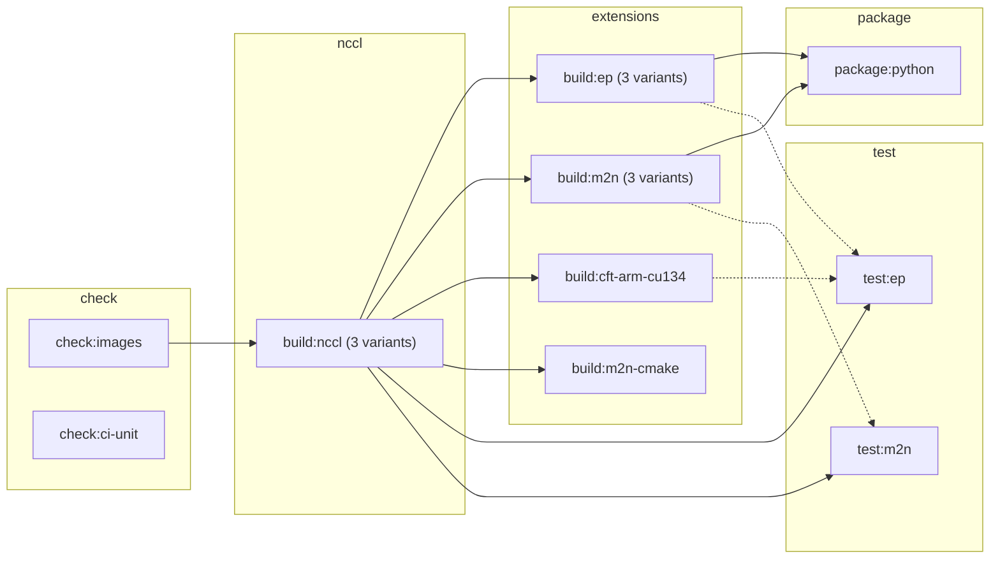

# nccl-extensions CI

The parent pipeline (`.gitlab-ci.yml` plus `.gitlab/ci/nccl-build.yml`) builds NCCL and the two
extension libraries, `nccl_ep` and `nccl_m2n`, on the IPP6 Kubernetes runners (`ipp6-k8s-x86`,
`ipp6-k8s-arm`), packages one Python wheel, and triggers one test child per module (`test:ep`,
`test:m2n`). A child installs the parent's artifacts on a GPU cluster and runs the tests there;
nothing is compiled on a GPU cluster.

## Pipeline



Solid edges are `needs`; dotted edges are `needs` with `optional: true`.

## Stages

| Stage | Jobs | Purpose |
|---|---|---|
| check | `check:images`, `check:ci-unit`, `github-sim:prepare`, `github-sim` | verify both pinned NCCL CI image tags exist before anything builds; run the CI unit tests when `.gitlab/ci/` or `python/build_assets/` changes; the public-release gate from `gpucomms/cicd-platform` on merge-request pipelines |
| nccl | `build:nccl` (three-entry matrix) | build NCCL from `third_party/nccl` once per variant, registry-cached, into `.ci/nccl-<variant>/` |
| extensions | `build:ep`, `build:m2n` (three-entry matrices, `allow_failure`), `build:m2n-cmake` (blocking), `build:cft-arm-cu134` (`allow_failure`) | build each extension library and its test binaries against the matching NCCL artifact; guard the m2n CMake path; build the CFT variant of EP |
| package | `package:python` | one cp312 wheel plus sdist from the x86 cu12 and cu13 module artifacts |
| test | `test:ep`, `test:m2n` (triggers) | start a module's child once every artifact it installs is final; on merge-request pipelines only when that module or shared CI infrastructure changed, on branch, tag and web pipelines always |

## Build variants

`build:nccl`, `build:ep` and `build:m2n` are `parallel:matrix` jobs over ARCH x CUDA, so the
generated names are `build:nccl: [x86, cu12]`, `build:nccl: [x86, cu13]`, `build:nccl: [arm, cu13]`
and likewise for `build:ep` and `build:m2n`; the children reference them verbatim in
`needs: pipeline:`. Each entry's rule merges a `.variant-*` anchor (image,
node selector, pod size, gencode) and the artifact directories into the job. An NCCL artifact holds
`build/` (`include/`, `lib/`) and `NCCL_COMMIT`; module jobs point `NCCL_HOME` at that `build/`.

| Entry | Runner tag | Image | Gencode | NCCL artifact | Module artifacts |
|---|---|---|---|---|---|
| `[x86, cu12]` | `ipp6-k8s-x86` (amd64) | NCCL CI image, `cu${NCCL_CI_CUDA12_VERSION}`; `build:ep` uses `nvidia/cuda:12.9.2-devel-ubuntu22.04` | `sm_90` | `.ci/nccl-x86-cu12` | `.ci/ep-x86-cu12`, `.ci/m2n-x86-cu12` |
| `[x86, cu13]` | `ipp6-k8s-x86` (amd64) | NCCL CI image, `cu${NCCL_CI_CUDA13_VERSION}` | `sm_90` | `.ci/nccl-x86-cu13` | `.ci/ep-x86-cu13`, `.ci/m2n-x86-cu13` |
| `[arm, cu13]` | `ipp6-k8s-arm` (arm64) | NCCL CI image, `cu${NCCL_CI_CUDA13_VERSION}` | `sm_100` | `.ci/nccl-arm-cu13` | `.ci/ep-arm-cu13`, `.ci/m2n-arm-cu13` |

## Recipes

**NCCL.** `build:nccl` runs `.gitlab/ci/build-nccl.sh`: `make src.build` in `third_party/nccl` with
the variant's `NVCC_GENCODE`, then copies `build/` into `${NCCL_ARTIFACT_DIR}`. Finished output is
cached in this project's generic package registry (package `nccl-ci-build-cache`; the runner cache has
no shared backend on the k8s runners). The fingerprint covers the NCCL commit, job image, gencode,
arch, nvcc and g++ versions, `build-nccl.sh`, `nccl-build.yml` and the make and nvcc override
variables, so any change to the recipe or its environment means one miss per variant and a stale
tarball is never a hit. Registry errors degrade to a miss and never fail the build; `NCCL_CACHE=0`
skips the registry.

**Extension libraries.** `build:ep` and `build:m2n` run `.gitlab/ci/scripts/build-module.sh ep|m2n`
on one fresh make tree: first `python/build_assets/build_lib.py <module> --build-dir` with `NCCL_HOME`
at the NCCL artifact, the same `make build` invocation the release uses (no MPI, no CUPTI, static cudart); then
make for the test binaries against the same tree, linked with the image's OpenMPI (`MPI_HOME`) and
the googletest submodule. The staged artifact is what the child installs:

| Module | Artifact contents |
|---|---|
| ep | `lib/libnccl_ep.*`, `include/nccl_ep.h`, `include/nccl_ep/`, `test/nccl_ep/{ep_test,ep_bench,af_test}` and the gtest `test_*` binaries |
| m2n | `lib/libnccl_m2n.so`, `include/nccl_m2n.h`, `bin/{multi_dim_geometry_test,multi_dim_test_mpi,basic_api_test_local,basic_api_test_mpi,reshard_bench,reshard_batch_bench_user_window}` |

**CMake guard.** `build:m2n-cmake` runs `.gitlab/ci/scripts/build-cmake.sh m2n` against the x86 cu13
NCCL artifact: configure `nccl_m2n` with `NCCL_M2N_BUILD_TESTS=ON` and `NCCL_M2N_BUILD_BENCH=ON`,
build, install, and assert the installed layout (shared and static library, header, `lib/cmake/NCCLM2N`
package files). The tests and benches link the hidden-visibility library, so a public entry point
missing `NCCL_M2N_API` fails the link here instead of at a consumer. The job blocks the pipeline;
nothing it produces is consumed or executed. `nccl_ep/CMakeLists.txt` is not a standalone project,
so there is no EP guard.

**CFT.** `build:cft-arm-cu134` runs `nccl_ep/ci/build_cft_ci.sh`: the CFT
variant of EP for `sm_100` without CUPTI, `ep_test`, `ep_bench`, `test_cft_compatibility` and
`test_cft_driver_api`, with the driver-API gtest run against the mock driver in
`CFT_MOCK_DRIVER_LIB_DIR`. `NCCL_PREBUILT_DIR` points at the arm cu13 NCCL artifact, so NCCL is
restored rather than compiled. The job is `allow_failure`; its `cft_install/` artifact feeds the EP
child's `integration:cft-polyphe` and `integration:cft-pre-tyche` jobs.

**Wheel.** `package:python` runs `python/ci/build_ci_wheel.sh` with `EP_CU12_DIR`, `EP_CU13_DIR`,
`M2N_CU12_DIR` and `M2N_CU13_DIR` pointing at the x86 module artifacts: it stages each library's
`lib/` and `include/` the way `build_wheels.sh` does, builds one cp312 wheel plus the sdist into
`python/dist/` with an isolated Python 3.12, and checks contents, installation and imports. The wheel
is not auditwheel-repaired: the x86 cu12 EP library is built on glibc 2.35 (Ubuntu 22.04), above the
manylinux_2_28 policy.

## Build environment

Every build job except the x86 cu12 EP entry runs in NCCL's CI image,
`gitlab-master.nvidia.com:5005/nccl/nccl/ci:<version>-cu<X.Y><suffix>`, pinned by the `NCCL_CI_*`
variables in `.gitlab/ci/nccl-build.yml`. nccl-extensions builds no image of its own.

- `check:images` verifies with `crane` that both pinned tags exist before the NCCL builds start, so
  a missing tag fails once, naming the tag, instead of three image-pull timeouts.
- The `-dev` suffix tracks NCCL's development environment on purpose. The tag is a moving pointer
  that NCCL's image rebuilds overwrite, so the environment can change without a commit here. The
  NCCL cache fingerprint covers the image tag and the nvcc and g++ versions, not the image digest,
  so a rebuilt tag with the same compiler versions reuses the cached NCCL; `NCCL_CACHE=0` forces a
  rebuild.
- UBI8 ships python3 3.6, so on the NCCL CI image `build_lib.py` runs under `uv run --script` (its
  PEP 723 header asks for Python >= 3.10 and `packaging`).
- The x86 cu12 EP entry builds on `nvidia/cuda:12.9.2-devel-ubuntu22.04`: UBI8/GCC 8 needs the legacy
  `libstdc++fs` archive for `std::filesystem`, and when Python loads an EP library built that way
  beside EOS's newer libstdc++, incompatible filesystem symbols mix and crash in
  `std::filesystem::path` destruction during JIT setup; Ubuntu 22.04's libstdc++ provides it natively.
  The override applies to EP only; its NCCL still comes from the NCCL CI image's artifact, and the
  job apt-installs its toolchain, OpenMPI and python3.

## Design notes

- CI reproduces the release recipe: the libraries come from the same `build_lib.py` call the release
  uses. The deltas are velocity (registry-cached NCCL, gencode limited to the GPUs CI tests on) or
  testing additions (test binaries, the CFT build, the CMake guard).
- The matrix axis is `ARCH` and the runner tag is derived as `ipp6-k8s-${ARCH}`, because `tags:`
  can expand matrix variables but cannot read `rules:variables`; everything else per variant is a
  `.variant-*` anchor.
- `needs:parallel:matrix` is static on GitLab 17.7, so each module entry needs `build:nccl` by base
  name, i.e. all three NCCL entries; its rule selects the one it compiles against.
- A cross-pipeline `needs: pipeline:` fails immediately (`missing_dependency_failure`) when the parent
  job is unfinished, so each trigger `needs` every artifact its child installs.
- Module builds are `allow_failure` and the triggers need them with `optional: true`, so one broken
  variant fails only `package:python` and the child `setup:*` job that installs it.
- make is the product build; CMake is a compile-only guard.
- Gencode is `sm_90` on x86 and `sm_100` on arm, kept to what CI tests on (H100 on EOS, GB200 on
  Pre-Tyche).
- The toolchain and CUDA line track NCCL's build environment rather than a project-owned image.
- Extension jobs consume the NCCL artifact instead of cloning the submodule, so one pipeline builds
  against one NCCL commit, recorded in `NCCL_COMMIT`.

## Running the checks locally

```sh
python3 -m unittest discover -s .gitlab/ci/tests -v
python3 -m unittest discover -s python/build_assets/tests -v
```

`check:ci-unit` runs the same two suites on `python:3.12-slim`; toolchain and registry are shimmed.
`build-module.sh`, `build-cmake.sh` and `build_ci_wheel.sh` document their inputs in their header
comments and run outside CI with those variables set.
