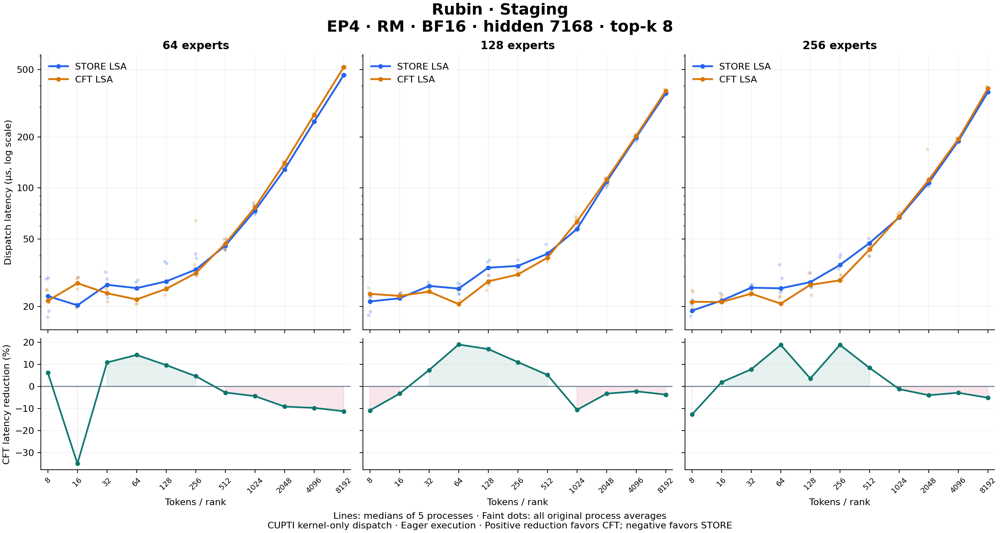
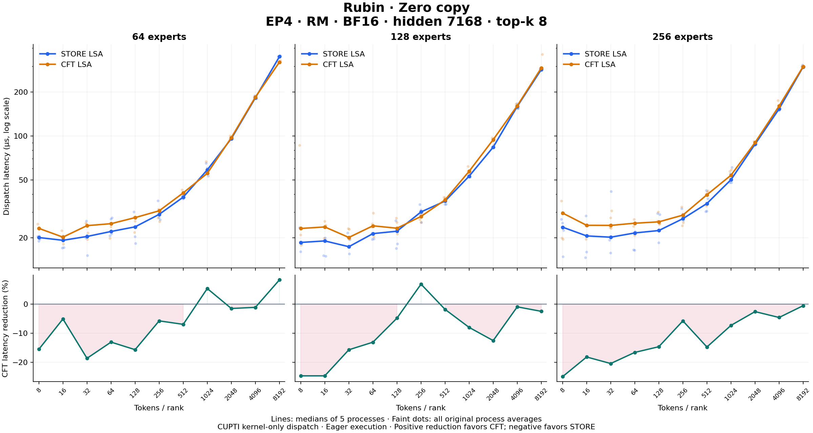
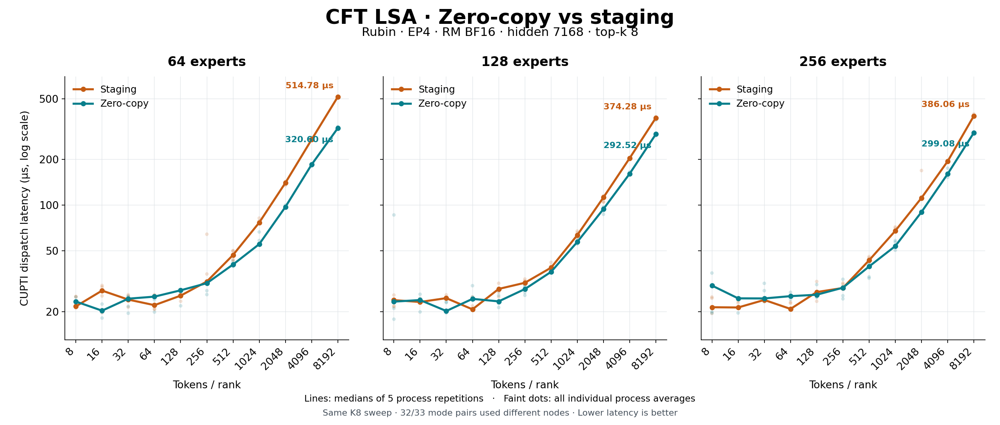

# MR298: LL CFT dispatch on the LSA rank-major kernel

This change adds CFT transport to the low-latency LSA rank-major dispatch and
pairs it with two-sided LSA combine. It supports staged output and direct payload writes
into a registered output window. General-kernel CFT zero copy will be enabled in a
follow-up MR; the existing general staged CFT and STORE zero-copy paths are preserved.

Set `NCCL_EP_LL_CFT=1` for CFT. The LSA path requires an unquantized rank-major
handle, a supported full hidden tile and one NVLink/LSA team. Small sources use
counted completion; large sources use ordinary writes followed by late count
publication. The choice is per source, so one dispatch may contain both modes.

## Staging

Staged CFT sends each routing header and payload into the internal receive
buffer. Receive groups wait for their source's completion, then copy the payload
and routing metadata to the output. `zero_copy=AUTO` and `OFF` retain this path.

```text
source shared tile -> CFT [header | payload] -> internal buffer -> output row
```

`NCCL_EP_LL_CFT_COUNTED_MAX_TOKENS` defaults to 128. Sources at or below the
threshold publish token counts early and use counted puts. The receiver waits
for the previous cumulative byte target plus `tokens * (header + payload)` and
executes a Fabric-to-Generic acquire before reading. Larger sources use ordinary
puts, drain all completion reports, and publish counts after the final CTA
census. The receiver acquires that late count and performs the same proxy
acquire; it leaves the cumulative counted-byte target unchanged.

### Staging measurements

Rubin EP4, RM BF16, hidden 7168, top-k 8; CUDA 13.4.59 and NCCL 2.30.7. The full token sweep below was measured at `d858840f0066`. STORE and CFT use the same source, library and stock eager benchmark, matched on one node per cell. STORE uses the default TMA LSA dispatch kernel. Settings: five rotated repetitions, 20 warmups, 100 iterations and three adjacent A/A pairs per arm/cell.

Times are **median CUPTI kernel-only Dispatch averages in µs**. CFT latency reduction is `(STORE − CFT) / STORE × 100`; positive favors CFT, negative favors STORE. Default grids are 64/128/128 CTAs for E64/E128/E256, respectively, matched between arms. CFT warp counts can differ from STORE's default 32; equal grids do not imply equal achieved occupancy.

#### 64 experts

| Output | Tokens/rank | STORE LSA | CFT LSA | CFT latency reduction |
|---|---:|---:|---:|---:|
| Staged | 8 | 23.07 µs | 21.63 µs | 6.2% |
| Staged | 16 | 20.33 µs | 27.45 µs | −35.0% |
| Staged | 32 | 26.88 µs | 23.96 µs | 10.9% |
| Staged | 64 | 25.68 µs | 22.02 µs | 14.3% |
| Staged | 128 | 28.15 µs | 25.43 µs | 9.7% |
| Staged | 256 | 33.02 µs | 31.49 µs | 4.6% |
| Staged | 512 | 45.77 µs | 47.04 µs | −2.8% |
| Staged | 1024 | 73.59 µs | 76.83 µs | −4.4% |
| Staged | 2048 | 128.46 µs | 140.21 µs | −9.1% |
| Staged | 4096 | 245.85 µs | 269.80 µs | −9.7% |
| Staged | 8192 | 462.64 µs | 514.78 µs | −11.3% |

#### 128 experts

| Output | Tokens/rank | STORE LSA | CFT LSA | CFT latency reduction |
|---|---:|---:|---:|---:|
| Staged | 8 | 21.43 µs | 23.76 µs | −10.9% |
| Staged | 16 | 22.37 µs | 23.11 µs | −3.3% |
| Staged | 32 | 26.45 µs | 24.49 µs | 7.4% |
| Staged | 64 | 25.52 µs | 20.67 µs | 19.0% |
| Staged | 128 | 33.88 µs | 28.15 µs | 16.9% |
| Staged | 256 | 34.72 µs | 30.89 µs | 11.0% |
| Staged | 512 | 40.95 µs | 38.82 µs | 5.2% |
| Staged | 1024 | 57.39 µs | 63.49 µs | −10.6% |
| Staged | 2048 | 108.84 µs | 112.42 µs | −3.3% |
| Staged | 4096 | 199.06 µs | 203.48 µs | −2.2% |
| Staged | 8192 | 360.83 µs | 374.28 µs | −3.7% |

#### 256 experts

| Output | Tokens/rank | STORE LSA | CFT LSA | CFT latency reduction |
|---|---:|---:|---:|---:|
| Staged | 8 | 18.93 µs | 21.34 µs | −12.7% |
| Staged | 16 | 21.67 µs | 21.26 µs | 1.9% |
| Staged | 32 | 25.83 µs | 23.83 µs | 7.7% |
| Staged | 64 | 25.62 µs | 20.80 µs | 18.8% |
| Staged | 128 | 27.85 µs | 26.85 µs | 3.6% |
| Staged | 256 | 35.17 µs | 28.55 µs | 18.8% |
| Staged | 512 | 47.37 µs | 43.39 µs | 8.4% |
| Staged | 1024 | 66.95 µs | 67.77 µs | −1.2% |
| Staged | 2048 | 107.22 µs | 111.51 µs | −4.0% |
| Staged | 4096 | 188.68 µs | 194.12 µs | −2.9% |
| Staged | 8192 | 367.10 µs | 386.06 µs | −5.2% |



## Zero copy

Set the group's `zero_copy` to `NCCL_EP_ZERO_COPY_ON` (or pass `--zcopy` to
`ep_bench`). CFT payloads go directly to registered output rows; real routing
headers and receive counters remain in the internal buffer. Self payloads use
TMA stores into the local output and retain their completion waits. The receiver
reads dense headers and does not copy payloads out of the staging buffer.

```text
source shared tile -> CFT payload put -> registered output row
routing metadata   -> CFT header batch -> internal dense headers
```

Counted sources count both payload and header bytes. For uncounted sources,
helper warps prepare whole headers while warp 0 streams payloads. A CTA join
makes those headers visible before warp 0 sends the batch through the existing
Generic-to-Fabric release. Helpers do not issue Fabric puts or modify payload
tiles. The final drain and late census cover payload and header completion;
there is no separate counted marker for ordinary sends.
The payload-issuing lane reads the immutable destination list and computes
reserved slots directly, avoiding per-token shared descriptor writes and
their warp handoff. TMA tile reuse and completion waits are retained.

Group creation reserves output endpoint space. The first eligible dispatch
collectively binds each registered output allocation. All ranks must have the
same output size and allocation-relative offset, and the driver binding
alignment and allocation bounds must pass. The output window/allocation must
outlive the EP group; later dispatches must reuse its pointer, window, shape
and datatype. Destroy the group before deregistering or freeing the output.
Perform the first bind eagerly, outside CUDA graph capture.
Logical-endpoint driver entry points are resolved at runtime, so optional CFT
binding APIs do not become load-time dependencies.

Explicit CFT zero copy is rejected when the actual selector chooses the general
kernel, including `NCCL_EP_LL_CFT_LSA=0`, `NCCL_EP_DISPATCH_LSA=universal`,
expert-major output, or an unsupported hidden tile. Public binding, adapter
dispatch and JIT cache lookup use the same LSA eligibility requirement. It does not silently fall back to staged CFT.

### Zero-copy measurements

The method and units match staging.

#### 64 experts

| Output | Tokens/rank | STORE LSA | CFT LSA | CFT latency reduction |
|---|---:|---:|---:|---:|
| Zero-copy | 8 | 20.13 µs | 23.26 µs | −15.5% |
| Zero-copy | 16 | 19.27 µs | 20.26 µs | −5.1% |
| Zero-copy | 32 | 20.47 µs | 24.29 µs | −18.7% |
| Zero-copy | 64 | 22.15 µs | 25.05 µs | −13.1% |
| Zero-copy | 128 | 23.83 µs | 27.57 µs | −15.7% |
| Zero-copy | 256 | 29.02 µs | 30.70 µs | −5.8% |
| Zero-copy | 512 | 38.07 µs | 40.73 µs | −7.0% |
| Zero-copy | 1024 | 58.55 µs | 55.43 µs | 5.3% |
| Zero-copy | 2048 | 95.90 µs | 97.37 µs | −1.5% |
| Zero-copy | 4096 | 182.59 µs | 184.68 µs | −1.1% |
| Zero-copy | 8192 | 349.65 µs | 320.60 µs | 8.3% |

#### 128 experts

| Output | Tokens/rank | STORE LSA | CFT LSA | CFT latency reduction |
|---|---:|---:|---:|---:|
| Zero-copy | 8 | 18.63 µs | 23.23 µs | −24.7% |
| Zero-copy | 16 | 19.08 µs | 23.79 µs | −24.7% |
| Zero-copy | 32 | 17.42 µs | 20.16 µs | −15.7% |
| Zero-copy | 64 | 21.41 µs | 24.22 µs | −13.1% |
| Zero-copy | 128 | 22.24 µs | 23.32 µs | −4.9% |
| Zero-copy | 256 | 30.15 µs | 28.09 µs | 6.8% |
| Zero-copy | 512 | 35.78 µs | 36.44 µs | −1.8% |
| Zero-copy | 1024 | 53.01 µs | 57.27 µs | −8.0% |
| Zero-copy | 2048 | 83.77 µs | 94.30 µs | −12.6% |
| Zero-copy | 4096 | 159.29 µs | 160.84 µs | −1.0% |
| Zero-copy | 8192 | 285.35 µs | 292.52 µs | −2.5% |

#### 256 experts

| Output | Tokens/rank | STORE LSA | CFT LSA | CFT latency reduction |
|---|---:|---:|---:|---:|
| Zero-copy | 8 | 23.71 µs | 29.63 µs | −25.0% |
| Zero-copy | 16 | 20.65 µs | 24.41 µs | −18.2% |
| Zero-copy | 32 | 20.24 µs | 24.38 µs | −20.5% |
| Zero-copy | 64 | 21.64 µs | 25.24 µs | −16.6% |
| Zero-copy | 128 | 22.48 µs | 25.78 µs | −14.7% |
| Zero-copy | 256 | 27.10 µs | 28.67 µs | −5.8% |
| Zero-copy | 512 | 34.44 µs | 39.53 µs | −14.8% |
| Zero-copy | 1024 | 50.12 µs | 53.80 µs | −7.3% |
| Zero-copy | 2048 | 87.77 µs | 90.06 µs | −2.6% |
| Zero-copy | 4096 | 153.28 µs | 160.37 µs | −4.6% |
| Zero-copy | 8192 | 297.39 µs | 299.08 µs | −0.6% |



## CFT output-mode comparison

CFT zero-copy and staging from the K8 sweep above, with five process repetitions per cell. The modes used different nodes for 32 of 33 shapes, so this is a descriptive comparison.



[PNG](figures/cft-zero-copy-vs-staging.png)

## Kernel ownership and phases

`device/ll/ll_dispatch_lsa.cuh` owns STORE SIMT/TMA dispatch. The separate
`device/ll/ll_dispatch_cft_lsa.cuh` owns CFT LSA dispatch, routing state, packed
counts and receive handling. It reuses `ll_ep_cft.cuh` for transport primitives;
`ll_common.cuh` contains the shared epoch helpers and transport-independent
rank-major metadata recording. General CFT remains in `ll_ep.cuh`.

The CFT entry point exposes these phases; helper comments specify participating
threads, shared-state ownership and the ordering each handoff provides.

| Phase | Helper | Participants and handoff |
|---|---|---|
| Initialize | `initDispatchCftLsa` | Entire CTA; carve buffers, initialize sender and clear masks before the CTA barrier. |
| Send | `dispatchSendPhaseCftLsa` | Entire CTA; schedule sender and helper warps with the existing barriers. |
| Route and reserve | `preprocessRoutingCftLsa`, `lsaCftReserve` | Helper warps deduplicate routes and clear sentinels; barrier A hands off to warp 0's range reservations. |
| Headers and payloads | `prepareTokenHeadersCftLsa`, `lsaCftPrepareHeaders`, `streamPayloadsCftLsa`, `lsaCftSendToken` | Uncounted zero-copy header helpers overlap warp 0's payload stream; their join precedes header puts. |
| Complete and publish | `cftDrainSender`, `lsaCftFinishAndPublish` | `dispatchSendPhaseCftLsa` schedules lane-zero completion and barrier B before self counts and the final source-wide census. |
| Receive readiness | `awaitSourceReadyCftLsa`, `syncAndRecvCountsCftLsa` | Each active group's first lane polls its source; the CTA-wide fallback also includes inactive groups. |
| Record output | `recordRecvTokensCftLsa` | Complete active warps record disjoint slots after readiness. |

`selectLowLatencyEpoch` remains before initialization. Full SEND+RECV advances
once through `completeFullLowLatencyEpoch`, using the elected last SEND CTA,
**before** receive readiness; this helper does not wait for receive completion.
Split SEND saves its pending epoch, and split RECV advances it through
`selectLowLatencyEpoch`. SEND-only returns before the full-call completion
helper. Both parity banks and next-bank clearing retain the same lifecycle.

`LlDispatchAlgo::kCftRmLsa` has its own generated include, runtime family and disk
variant name. Counted mode, zero-copy mode, warp count and mask specialization
remain in its cache identity. Selection overrides, launch geometry, shared-memory
sizing, general fallback, zero-copy rejection and dispatch/combine pairing are
unchanged.

## Completion protocol and launch policy

Helpers prepare destinations and clear sentinel rows; CTA 0 also clears the
next count bank. These operations precede reservation/count publication. A
receive group must acquire its own rank's sentinel-clear mark before writing
remote metadata. Counted sources publish through an early reservation census;
uncounted sources publish through the final census after every CTA drains its
puts and executes a Fabric-to-Generic release. Self TMA completion and its
async-proxy fence remain before the final CTA join. The elected publisher
acquires the census before publishing and resetting local slot/census state.
The receiver's proxy acquire remains before its receive-group barrier and reads.

The count word contains a counted-mode bit, an arrival count and the token
count. Remote arrival completion is 1; self completion is twice the source CTA
count. Host bounds prevent packed-field overflow. Receivers decode each source
independently, including zero-token sources and counted/uncounted transitions.
The existing split dispatch, parity and next-bank clear lifecycle is retained.
The completion-report-to-remote-visibility ordering still requires CFT-owner
review; shared-memory reduction alone is not a correctness argument.

LSA CFT dispatch pairs with two-sided LSA combine. STORE retains its
one-sided and automatic combine modes. Selecting general CFT with
`NCCL_EP_DISPATCH_LSA=universal` or `NCCL_EP_LL_CFT_LSA=0` also selects general
combine. This keeps dispatch and combine on the same metadata cleanup protocol:
LSA kernels clear the next bank, while general CFT consumers clear used entries.

CFT receive warps are selected from configured capacity and local experts,
rounded up to a power of two with a minimum of two and the existing group
ceiling. Current local token count does not reduce the receive capacity. The
original expert-dependent CTA grid, group ownership and one-CTA launch bound
remain unchanged. STORE keeps its default 32 warps. Matched CTA grids do not
assert identical achieved occupancy or performance during model computation.

A one-word token mask is selected only for SM107/212 physical SMs,
full 212-SM budget, EP4/E384/H7168/K6 BF16/int64, capacity 2048..8192, and the
original G2/B192/W32 geometry. At most 43 tokens belong to a CTA there. Its
runtime/disk identity and pre-cache bounds distinguish it from the eight-word
fallback. It is CFT-only and changes neither the grid nor completion ordering.

## Rebase validation

Based on main `2cedd3c8ac38`. The rebased source passed **73 GPU validation processes**, including **1,632 changing-data dispatches**, staged/zero-copy full and split calls, mixed counted/uncounted and zero-token sources, self-only/remote-only traffic, graph replay, STORE SIMT/TMA, STORE FP8, and general CFT fallback. The simplified selector suite passed 20 checks (10 with CFT LSA enabled and 10 disabled). All 14 driver checks passed, along with stock LL tests with CFT off/on.

The combine controls cover STORE one-sided/auto/two-sided modes, CFT two-sided selection, and explicit CFT one-sided rejection. Both receive-barrier paths passed; the CTA-wide fallback used a private host-bound bypass for 192 changing-data dispatches. Four production geometry rejections also passed. EP8, GPU sanitizers, timeout fault injection, and performance sweeps were not rerun for this rebase.

The initial STORE auto-combine engagement check used an unregistered combine
input and selected two-sided combine while data validation passed. The private
harness now registers that input; all seven combine-mode checks passed.
Production code is unchanged apart from reviewed comments; documentation and
selector tests are simplified. No latency equivalence is inferred from these checks.

## Historical implementation validation

The implementation at `ee21829b578f`, before this rebase, passed 67 GPU
validation processes, including 1,632
changing-data dispatches across both parity banks. Coverage includes
staged/zero-copy, full/split, counted-boundary and large transitions, mixed and
zero-token sources, self-only/remote-only traffic, fixed-shape graph replay,
STORE SIMT/TMA and FP8, and general CFT fallback. All 22 selector/JIT and 14
dynamic-driver checks passed, along with stock LL tests with CFT off/on.
Persistent stamps validate dispatch; separate benchmark cases validate dispatch
and combine.

Named receive barriers passed with inactive groups. Four private processes
passed another 192 changing dispatches through the CTA-wide fallback, using a
host-bound bypass with the same kernel source. The production limit is
unchanged, and four expected public geometry rejections passed. EP8, sanitizers
and timeout fault injection were not rerun for this source.

Matched implementation checks compare CFT at `dfd08ea84ff18` with
`ee21829b578f` on
Rubin EP4, RM BF16, H7168, K8. Each cell's arms use the same node and dependencies,
with rotated execution order and validation in every process. Main and
confirmation cohorts use five repetitions per arm, 20 warmups and 100 timed
iterations. The separate longer-sampling cohort uses ten repetitions, 200
warmups and 1,000 iterations. Each cohort has three adjacent A/A pairs per arm
and cell; cohorts and sampling methods are not pooled.

Launch geometry and shared-memory allocation match in all 15 main cells.
Registers and stack use are unchanged or lower in those cells; a separate
staged E64/T256 functional gate uses 126 → 127 registers and 64 → 48 stack bytes.
Generated machine code differs. These resource changes do not establish an
occupancy or latency improvement.

Times below are median CUPTI kernel-only Dispatch averages in µs. Change is
`(cleanup / before − 1) × 100`; positive means slower. A/A is the largest
absolute adjacent second/first deviation, a descriptive observation rather than
a confidence interval. “Slower pairs” counts repetitions in which cleanup is
slower than its matched before arm.

| Cohort | Output | Experts | Tokens/rank | CFT before | CFT cleanup | Change | Slower pairs | A/A before / cleanup |
|---|---|---:|---:|---:|---:|---:|---:|---:|
| Main | Staged | 64 | 128 | 25.53 | 25.62 | +0.35% | 2/5 | 8.49% / 13.78% |
| Main | Staged | 64 | 8192 | 519.26 | 518.37 | -0.17% | 2/5 | 1.17% / 1.67% |
| Main | Staged | 128 | 128 | 24.65 | 26.34 | +6.86% | 4/5 | 25.91% / 38.73% |
| Main | Staged | 128 | 8192 | 384.49 | 383.46 | -0.27% | 2/5 | 0.28% / 1.28% |
| Main | Staged | 256 | 128 | 26.70 | 23.37 | -12.47% | 2/5 | 18.56% / 43.67% |
| Main | Staged | 256 | 8192 | 388.44 | 387.54 | -0.23% | 1/5 | 2.05% / 2.55% |
| Main | Zero-copy | 64 | 128 | 27.23 | 27.46 | +0.84% | 3/5 | 19.35% / 11.42% |
| Main | Zero-copy | 64 | 256 | 31.27 | 29.55 | -5.50% | 0/5 | 21.23% / 30.22% |
| Main | Zero-copy | 64 | 8192 | 324.13 | 322.22 | -0.59% | 3/5 | 1.09% / 2.08% |
| Main | Zero-copy | 128 | 128 | 26.34 | 24.70 | -6.23% | 2/5 | 25.96% / 16.36% |
| Main | Zero-copy | 128 | 256 | 29.80 | 28.60 | -4.03% | 2/5 | 14.26% / 7.94% |
| Main | Zero-copy | 128 | 8192 | 296.05 | 296.94 | +0.30% | 3/5 | 2.24% / 2.25% |
| Main | Zero-copy | 256 | 128 | 24.17 | 30.86 | +27.68% | 3/5 | 16.62% / 23.39% |
| Confirmation | Zero-copy | 256 | 128 | 23.75 | 24.79 | +4.38% | 4/5 | 5.15% / 7.18% |
| Longer sampling | Zero-copy | 256 | 128 | 23.66 | 23.52 | -0.59% | 5/10 | 61.35% / 42.43% |
| Main | Zero-copy | 256 | 256 | 30.83 | 29.81 | -3.31% | 3/5 | 6.98% / 20.94% |
| Main | Zero-copy | 256 | 8192 | 299.71 | 303.76 | +1.35% | 3/5 | 3.51% / 1.05% |

All 180 primary and 204 A/A timings for these two arms passed dispatch and
combine validation, along with 34 engagement gates. No failures, missing
samples, exclusions or replacements occurred.

The large staged medians change by −0.17% to −0.27%; large zero-copy changes
range from −0.59% to +1.35%, with 3/5 pairs slower in each cell. Small-cell
results remain uncertain. Staged E128/T128 is 6.86% slower, with 4/5 slower
pairs. Zero-copy E256/T128 is slower in both short-method cohorts; longer
sampling changes the median direction but still has large A/A excursions.
That longer run does not erase the two adverse observations or prove stable
timing. These checks do not establish exact latency parity, exclude a
shape-specific regression, or establish a cleanup speedup. STORE regression
was tested functionally; no STORE latency claim for that implementation is made.

## Token-sweep validation and measurement scope

The sweep completed **1,584/1,584 processes**: 660 primary timings, 792 A/A timings and 132 nonuniform engagement checks. Every process passed dispatch and combine validation. No failures, missing runs, exclusions or replacements occurred in this sweep. Independent parsing reproduced every median and A/A ratio.

Six persistent K8 rank-major zero-copy full/split processes passed 288 changing-data dispatches across E64/E128/E256, including 32↔8192 transitions, mixed and zero-token sources, and both parity banks. The same executable source also passed eight K8 E64 full/split dispatch/combine cases, four K8 E64 nonuniform graph cells with zero-token sources, and four K8 two-node EP8 split cases. Graph checks use a private harness that captures combine on every rank. The unchanged selector and driver checks passed 18 selection checks, 14 dynamic-lookup tests and the optional-driver import check. No sanitizer coverage is claimed.

CFT has lower medians in **16/33 staged cells** and **3/33 zero-copy cells**. STORE wins remain visible as negative reductions. Zero-copy E64/T8192 measures 349.65 µs STORE versus 320.60 µs CFT (**8.31% lower latency**), exceeding its observed A/A deviations of 1.26% for STORE and 0.11% for CFT. The other two positive zero-copy median reductions are smaller than their observed A/A variation.

The largest unfiltered A/A second/first deviations are **78.81% for STORE** (staged E128/T512, 42.34 → 75.71 µs) and **91.96% for CFT** (staged E128/T256, 30.73 → 58.99 µs). These describe observed run-to-run variation, not a confidence interval.

The predeclared exclusion rule is a primary value above five times its cell/arm minimum, with at most one linked replacement. A/A values are unfiltered. Host-observed timing is separate. The stock CUPTI log does not print exact captured activity counts or dropped-record totals.

## Restrictions

- CFT LSA requires unquantized rank-major BF16/FP16, a full supported hidden tile and one LSA team. Explicit CFT zero copy rejects general-kernel selection, including `NCCL_EP_LL_CFT_LSA=0` and forced general dispatch (`NCCL_EP_DISPATCH_LSA=universal`).
- CFT LSA supports two-sided combine only. Forcing `NCCL_EP_COMBINE_LSA=1sided` for this path is rejected.
- Bind zero-copy output eagerly before graph capture. The registered window/allocation must outlive the group; later calls must reuse its pointer, shape and datatype.
- Mixed expert-major/rank-major CFT groups require `NCCL_EP_LL_CFT_LSA=0`; CFT zero copy is unavailable there. CFT-owner review of completion ordering remains requested.
