# Hierarchical dispatch (MR !375)

Expert-parallel dispatch sends each token to the GPUs that own its selected experts. When several of those GPUs share a remote local shared-access (LSA) domain, sending a separate copy to every GPU repeats the same payload over the network. Hierarchical dispatch sends one copy to a destination GPU in that domain, which forwards it to the other destinations over the local fabric. This approach makes sense when the network traffic saved outweighs the extra local forwarding and coordination; the benefit generally grows with token volume and the number of destinations sharing a domain. Direct dispatch avoids that forwarding step and can be faster for small token counts or little destination overlap.

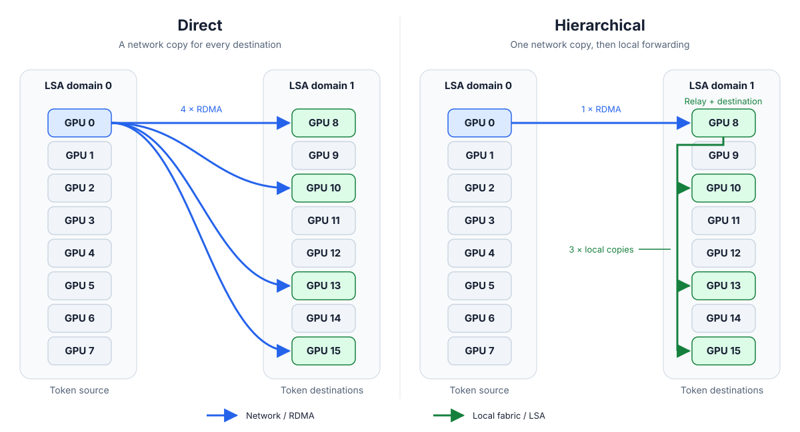

*Two domains of eight GPUs match the CollectiveX topology. This token needs GPUs 8, 10, 13, and 15; the other GPUs do not receive it. Blue arrows cross the network; green arrows stay within an LSA domain. This is one illustrative routing pattern, not the average fanout.*

Hierarchical dispatch and rank masking (`enable_mask`) are mutually exclusive: AUTO retains baseline for masked groups, while forcing hierarchy fails group creation.

## How often can we share a network copy?

The useful event is a token targeting **multiple GPUs in the same remote domain**. Let **D** be the number of equally sized LSA domains, **M** the GPUs per domain, and **K** the token's top-k. A particular GPU or domain receives the token unless every selected expert misses it. The following approximation makes that probability easy to read:

A domain receives **K/D expert selections on average**. With more domains at fixed K, destinations spread out and there is less overlap to exploit. More GPUs per domain create more opportunity to merge network copies: Direct already shares one copy among experts on the same GPU, so hierarchy saves traffic only when distinct GPUs need the token. The graph asks: **given that a remote domain needs a token, how likely is it to need that token on multiple GPUs?**

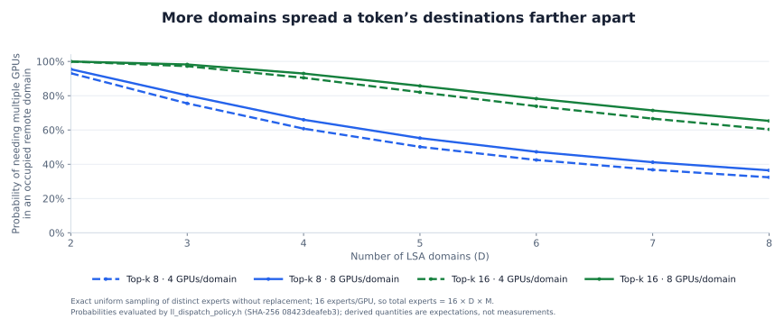

*All plots use exact uniform sampling of distinct experts without replacement, as in the production cost model. The short formula above is explanatory only. With E total experts and q experts on a GPU or domain, the exact hit probability is 1 − choose(E − q, K) / choose(E, K). We keep 16 experts per GPU, so E grows with the topology. Routing skew and locality are not modeled.*

## How much network traffic can we save?

There are (D − 1)M remote GPUs and D − 1 remote domains. Multiplying those counts by their exact hit probabilities gives **G**, the expected Direct network copies per token, and **H**, the expected hierarchical network copies. With T local tokens of P payload bytes each, the expected outgoing network payload falls from TPG to TPH.

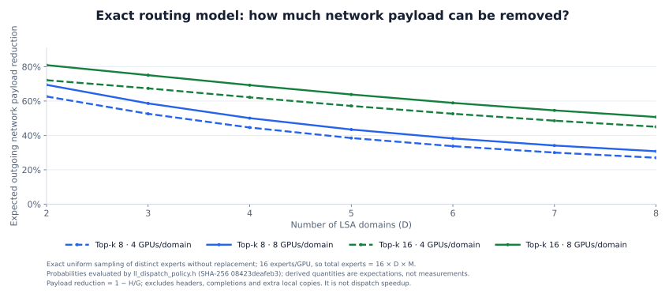

For the **CollectiveX configuration—two domains of eight GPUs, top-k 6, and 384 experts (24 per GPU)—G ≈ 2.58 and H ≈ 0.985**: about **62% less outgoing network payload**. At equal effective network bandwidth, the payload transfer alone would take about **2.62× less time**. Local forwarding, completions, synchronization, and contention prevent interpreting that ratio as a dispatch speedup.

## Why Direct wins at low token counts

At low token counts, dispatch is primarily **latency bound**: too little network work is saved to repay the extra dependent hop. Direct puts a token on its destination GPU immediately; hierarchical delivery first lands it on a relay, then forwards it within the receiving LSA domain. With otherwise comparable scheduling and completion costs, Direct has the shorter critical path. More tokens or larger payloads can make network bandwidth the limiting resource and allow accumulated traffic savings to outweigh forwarding and coordination. The precise balance depends on payload size, topology, and resource availability.

## Why Direct needs FULL connectivity

**For the lowest latency at low token counts, we need FULL connectivity to avoid the extra receive-side hop.** Each source GPU must be able to write directly to any required remote destination GPU. RAIL connectivity reaches only the matching rail peer, so other destinations still need LSA forwarding. FULL lets us use Direct for small sends and hierarchical delivery for larger sends on the same connections. The price is a larger remote peer set: **eight peers per source GPU in this two-domain topology, rather than one rail peer**. That creates more posting and completion work for CTAs (GPU thread blocks) and their warps, and increases the GIN contexts needed to process peers in parallel. With **A active send CTAs**, the preferred peer-parallel Direct path uses **8A distinct contexts**; relay posting can use **one per CTA**. FULL therefore trades additional GPU work and context demand for the ability to avoid the extra receive-side hop.

RAIL showed promising bulk results: **144.11 µs versus 296.86 µs for the ordinary baseline, a 2.06× speedup**, in the historical two-node B200 test with eight GPUs per domain, 256 tokens per rank, capacity 512, BF16 rank-major dispatch, hidden size 7168, top-k 8, and 256 experts. This RAIL experiment used a different workload from the CollectiveX example above and is not a measurement of the current implementation. RAIL also regressed at low token counts, where its restricted first hop cannot provide Direct delivery to arbitrary remote GPUs. **This PLC limits itself to FULL connectivity**, which supports both delivery modes and preserves the short path for latency-sensitive small sends. RAIL remains a separate direction for future work.

*Both panels show hierarchical delivery. Using source GPU 1 makes the distinction visible: its rail peer, GPU 9, is not a destination for this token. FULL can instead land on required destination GPU 8. Faint lines show other reachable peers; bold lines show actual traffic. Local-copy counts show forwarding to other GPUs; staging-to-final copies, output compaction, and control traffic are omitted. The current kernel uses FULL for both Direct and hierarchical delivery; RAIL is deferred. FULL does not require a larger CTA grid, and the Direct context counts above describe preferred parallel posting, not a mandatory minimum.*

## Why switching must be rank-local

Token counts can differ sharply between ranks: in the same dispatch, one rank might send **one token** while another sends **256**. Making every rank use hierarchical delivery would add a relay hop to the small send; making every rank use Direct would give up the bulk sender's network savings. Agreeing on a single mode through another collective would add latency and still force a compromise. Instead, **each rank chooses its send mode independently from its current local token count**, inside the running kernel. Today, counts up to `min(32, numRdmaSendCtas − 1)` use Direct; larger counts use hierarchical delivery. The choice can change on the next dispatch without changing the connections or packet format.

That independence requires a **shared protocol that accepts both modes in the same operation**. A rank with few outgoing tokens may receive bulk traffic, and even a rank with zero outgoing tokens must still receive and publish its required empty completion. Receivers therefore discover each source's count, delivery mode, and completion on the GPU, rather than assuming that peers chose the same mode as themselves. FULL connectivity, logical send-CTA indices, buffer strides, and completion rules remain common across ranks; physical workers can differ while preserving those logical identities. This compatibility applies to Direct and hierarchical delivery within the new family; ranks cannot independently substitute the ordinary baseline protocol.

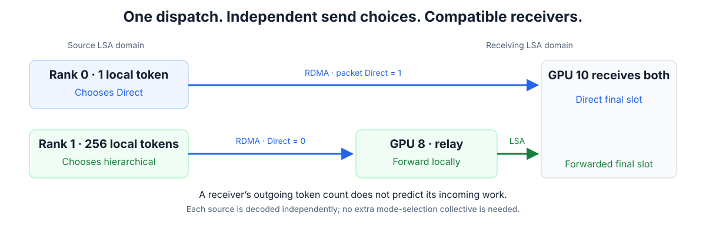

*The send decision uses each source's local count. Receive work follows each source's actual publications; it cannot be inferred from the receiver's own send mode or outgoing count.*

## A compact header reuses the expert routing table

Each packet keeps its token ID, top-k expert IDs, and weights, then adds an **8-byte delivery extension containing exactly two 32-bit words**. **Word 0, `deliveryEntries`, occupies extension bytes 0–3** and holds the routing-entry mask. **Word 1, `control`, occupies extension bytes 4–7**: bits 31–5 are reserved zeros, bit 4 selects Direct delivery, and bits 3–0 hold the compact epoch label. These are two fields in the same extension, not separate headers.

In `deliveryEntries`, **bit j enables top-k entry j**, whose existing expert ID identifies the destination GPU. This reuses information already in the packet: one bit per routing entry supports up to **32 top-k entries without limiting the domain to 32 GPUs**. The two worked tokens below use the same six entries, targeting **GPUs 8, 10, 13, and 15**, as in the topology example. Both have bits 0–5 set and the other 26 bits zero; only the Direct token sets bit 4 of the separate `control` word. Two entries can name different experts on the same GPU; both entry bits stay set, while destination deduplication ensures that GPU receives only one copy.

*Byte offsets are relative to the start of the delivery extension. Colors connect each enabled bit to its top-k entry; different entries keep different colors even when they share a GPU. The 32 mask bits have equal visual widths; control fields are enlarged for readability.*

**The four-bit packet epoch is not needed for readiness; the current receiver does not check it.** The label is `(epoch + 1) & 15`, so it repeats every 16 epochs. For example, epochs 42 and 58 both produce label `1011`, but their full ready tags are **43 and 59**. At epoch 58, an old slot tagged 43 is not copied just because its packet label matches. Receivers first acquire the required completion, then check the full 64-bit ready tag; remote Direct completion also requires its full-width strong VA counter to equal 59. Relay publication and bank-reuse ordering protect forwarding. Separately, truncated sparse completion words are cleared after all readers finish, preventing stale counts from authorizing completion after a long gap. These completion protections remain necessary even if the packet label is removed.

> **Future optimization: carry delivery bits in weight signs for zero-copy**
>
> If routing weights are guaranteed nonnegative, their sign bits could encode the top-k delivery mask: sign bit j set means entry j is enabled for forwarding; all sign bits clear means Direct delivery. Together with removing the unused packet epoch label, this could eliminate the separate 8-byte delivery extension. This is especially useful for a future zero-copy path, where adding a transport header could otherwise require extra metadata storage or packet assembly.
>
> Consumers would recover the original nonnegative weights by clearing the sign bits before arithmetic; encoding and decoding must be bitwise so zero weights work too. The design needs an explicit nonnegative-weight contract and a way to tag routing metadata without exposing modified application weights. Full completion epochs, ready tags, and counters remain separate. This is a proposal, not implemented zero-copy support; padding means fewer header bits alone may not reduce today's staged transfers.

## Completion makes mixed delivery safe

**Both modes signal final completion through the same location on each receiving GPU: `done[bank][sourceRank][sendCta]`.** What changes is who writes it and how. For Direct delivery, the remote sender writes `done` through GIN, bundled with a strong VA counter update ordered after its packet and ready-tag writes. For hierarchical delivery, the relay writes that same `done` location through LSA with release ordering, after forwarding the packets. The final receiver polls one common completion interface, decodes the completion type, and additionally checks the full-width VA counter for Direct. It then reads full ready tags and compacts only slots tagged with the current epoch + 1.

Hierarchical delivery also needs an **earlier, separate signal from sender to relay**. Strong GIN publication tells the relay that packets are available to forward; it does not tell final receivers that delivery is complete. After consuming those packets, the relay resets that signal and publishes to the shared `done` location. The distinction is **packet arrival at the relay versus final delivery completion**.

Here, **`sendCta` identifies a logical producer and its assigned subset of the source's tokens**, so one completion covers that subset rather than a single token. Logical producer indices remain consistent across ranks even when their physical CTA grids differ. **`bank` selects one of two payload/control banks using epoch parity**. All readers must finish before source-count cleanup and eventual reuse of that bank. With matched operations ordered on the same stream, a faster peer cannot finish the intervening operation and reuse the bank before the slower rank participates; this protects cleanup and reuse from racing live traffic. It does not permit arbitrary concurrent operations on the same LL resources.

## Why pack the completion into 64 bits?

A completion flag alone says that one producer finished; it does not tell the receiver **which other producers should exist**. Consider a capacity-512 group with 256 logical RDMA send CTAs, but a source sending only **three tokens**. Only send CTAs 0, 1, and 2 are active. The receiver must learn that source count so it can skip inactive CTAs instead of waiting for completions that will never arrive. The count also bounds token-slot scanning; it is the source's input count, **not the number of rows this particular GPU will receive**. Send CTA 0 carries that count in its completion. A zero-token source still publishes through CTA 0, explicitly announcing that no payload will follow.

The **packed word combines that count with completion identity and type in the existing `done` slot**. Its marker distinguishes a packed count from an ordinary full-epoch done value. The Direct bit tells the receiver whether it must additionally check the strong VA counter. The remaining high bits hold 30 epoch bits, and the low 32 bits encode the source count plus two. Thus three tokens encode as **5**, and zero tokens encode as **2**; an untouched zero word is never mistaken for a completed empty source. Packing avoids a separate source-count array or an extra count publication. It is a compact encoding choice, not a fundamental requirement that completion use this exact 64-bit layout.

This differs from a simple ready flag and from a per-token ready tag: **one packed completion closes a producer's token subset and can identify an empty source**. Ordinary LL already combines counts with readiness, using destination count notifications such as a negative count encoding for LSA or a count-plus-one GIN signal. Those counts describe delivered rows in the ordinary protocol's channels. Here, completion is indexed by logical source/send-CTA ownership, must accept both delivery modes, and exposes source-count information needed to prune sparse work. The packed word is ordinary data in the registered completion buffer; the GIN or LSA publication mechanism makes it observable with the required ordering.

*Remote Direct completions use the packed word for each active send CTA; sparse relay/local counts use it in send CTA 0 with Direct = 0. This includes local delivery from a source whose remote sends were Direct. Dense relay done instead carries the full epoch + 1. Learning the source count from CTA 0 does not complete its other active CTAs. Packed source-count words are cleared after all readers retire to prevent truncated-epoch aliasing across long gaps; cumulative Direct VA counters and sender history are preserved.*

## Selection policy: two decisions at different times

The shared protocol lets ranks choose different delivery modes, but **selecting the kernel family is a separate, earlier decision**. In AUTO mode, the host first decides whether the ordinary baseline or the new compatible family is expected to perform better. Only after choosing the new family does the running kernel select Direct or hierarchical sending. Keeping those decisions separate preserves protocol agreement across ranks while adapting each sender to its own workload.

### 1. Host: choose the family from fitted expected gain

The host model uses **topology, configured token capacity, payload size, expert count, top-k, and context restrictions**. It uses the exact uniform-routing probabilities introduced above to estimate remote GPU copies G and remote-domain copies H. A fit to measured B200 dispatch timings then balances three costs: overhead that grows with the number of remote domains, local forwarding, and the RDMA traffic saved by merging copies. Payload-dependent costs scale with capacity and bytes per token. The coefficients come from measured two- and four-node cases, with larger-batch observations supplementing the fit; dispatch evaluates the fitted formula rather than running a new calibration.

Let **B** be the estimated ordinary-baseline latency and **Δ** the estimated new-family latency minus B. A negative Δ predicts a gain. AUTO selects the new family only when that gain exceeds **both 5 µs and 2% of B**. Otherwise it retains baseline. Unsupported call properties and restricted context budgets also retain baseline. The inputs to this family decision are shared configuration and collective call properties, so ranks agree on the wire protocol; **a rank's current local token count cannot independently switch it back to baseline**.

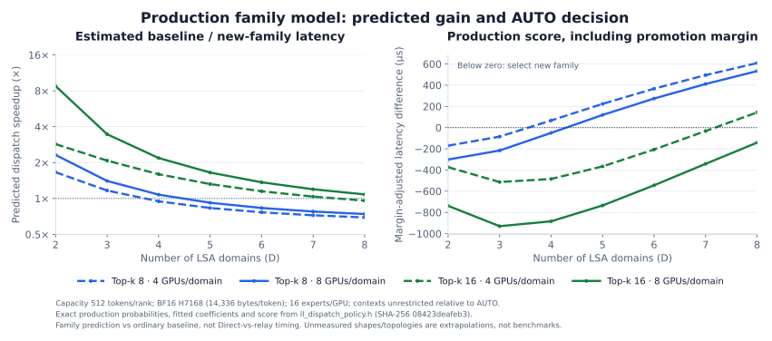

*Plots evaluate the current C++ policy directly, including exact probabilities, fitted coefficients, and the promotion margin. Predicted speedup is B / (B + Δ); the decision score includes the margin. Inputs: capacity 512, BF16 hidden size 7168, 16 experts per GPU, and unrestricted contexts relative to AUTO. These are predictions, not benchmark results. Top-k 16 and wider topologies extrapolate beyond the fit's calibration evidence; large predicted gains are not established performance. Reduced-SM configurations are a known weakness of the current model. The model selects baseline versus the new family, not Direct versus hierarchical delivery.*

### 2. Device: choose Direct or hierarchical from the actual count

Within the new family, **the kernel reads this rank's actual local token count** and uses Direct up to `min(32, numRdmaSendCtas − 1)` tokens, including zero; larger counts use hierarchical sending. The 32-token cutoff is a measured scheduling policy, **not a crossover calculated by the host model**. It is clamped below the logical RDMA send-CTA count to preserve the small-send scheduling regime; if the resulting cutoff is nonpositive, Direct is disabled. Each rank evaluates this choice independently inside the fused kernel, without a token-count collective, a device-to-host readback, or another kernel launch. The receiver still accepts either mode from every source.

Capacity and occupancy therefore have different jobs. A group sized for **512 tokens per rank** may qualify for the new family on the host, while a rank sending **one token** uses Direct and another sending **256 tokens** uses hierarchical delivery in the same dispatch. Capacity and stable configuration also determine JIT specialization and launch geometry; changing the active count changes the executed send path, not the physical grid already launched.

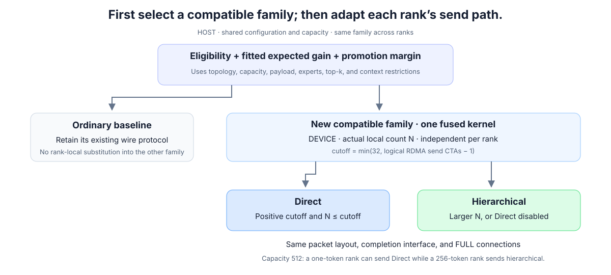

## Implementation: walking through the fused kernel

We now follow `dispatch_kernel_impl_hier` in execution order. On entry, it reads this rank's count, selects the send mode, and obtains the epoch, full tag, and bank parity. NCCL's **`ncclCoop` abstraction** supplies CTA and warp groups, their sizes, and thread/lane identities; `blockIdx.x` identifies the physical CTA. Warp 0 resets local per-source output counts, while incoming signaling state stays intact. These are setup for the first substantial scheduling decision below. A private device-count pointer, when used, must remain stable throughout dispatch.

### 1. Assign CTAs to outgoing work

**The grid size is a tuning choice, not a protocol requirement.** The retained full-device preset—**384 logical CTAs, 256 threads per bulk CTA, and a 2:1 RDMA share**—came from experiments with launch geometry, overlap, and worker roles. It provides many independent RDMA producers and enough workers for the receive side, while balancing register pressure, cooperative residency, and synchronization overhead. More CTAs are not automatically faster: the tuning record includes a small-token trial where a 128-CTA grid outperformed larger-workforce alternatives. That trial is evidence of the tradeoff, not a replacement for the retained bulk preset or proof that 384 is optimal everywhere.

The implementation bounds the full-device logical grid by **min(384, 3 × SM count)**; an explicitly reduced SM budget caps it further. The bulk specialization targets three resident CTAs per SM, and the JIT checks that the entire cooperative launch can reside on the GPU. Small-capacity configurations can use smaller physical grids while preserving the common logical indices. Thus the grid is a measured scheduling preset constrained by hardware resources; **the fitted family cost model does not calculate it**.

The launch size and the number of active send producers are different. Let **G** be the physical grid size and **S** the common logical RDMA send-CTA count. In the capacity-512 preset shown below, **G = 384 and S = 256**. Both delivery modes activate **max(1, min(S, N)) RDMA send CTAs** for N local tokens. Producer i owns tokens i, i + S, i + 2S, and so on: 16 tokens use 16 RDMA producers; 256 use 256; 512 still use 256, each staging two tokens. With zero tokens, one producer remains active to publish empty completion. The grid is not shrunk to that producer count, because it must also cover initialization and potentially substantial incoming traffic.

**Small Direct sends use N additional CTAs to overlap local forwarding with those N RDMA producers.** The first N CTAs stage and post remote traffic, while the last N independently forward the same tokens within the source's LSA domain. Thus the 16-token example has **16 RDMA producers + 16 local-copy producers**, within the existing 384-CTA launch. Each tail CTA builds its own local header and reads the original input payload, so it does not wait for RDMA staging. This split requires N to be positive and fit both S and half of G, keeping the ranges disjoint.

**Hierarchical sends prioritize the front max(1, min(S, N)) CTAs for RDMA staging and posting.** The 256-token example therefore uses **256 RDMA producers** in this phase. Local forwarding follows remote submission and the prefix grid join, reusing workers from the same grid rather than requiring an additional simultaneous set of local-copy CTAs. Direct calls that cannot use the overlap split follow that deferred local schedule too. Both modes share the staging structure, then differ in the posting operation; these are temporary send-phase roles, not permanent assignments for the whole kernel.

**Preparing and submitting RDMA traffic early is the priority because it feeds the limiting path in the targeted multi-domain workloads.** Remote receivers cannot progress until payloads are staged, posted, and transported; hierarchical traffic then also needs forwarding in the remote LSA domain. Delaying those submissions delays that entire chain. The preset provides 256 logical RDMA producers out of 384 logical CTA indices to expose parallelism along this path. Small Direct sends can spend otherwise available tail CTAs on local LSA copies without making RDMA producers perform those copies first. Bulk sends defer local forwarding until remote traffic has been submitted, allowing the network work to progress while local work follows. The objective is early network progress, not equal numbers of CTAs for RDMA and LSA.

*Tuned example geometry: 384 physical CTAs and 256 logical RDMA send CTAs; these counts are not protocol requirements. Ranges are schematic, not drawn to scale. CTAs without outgoing payload still participate in output-index clearing, the prefix barrier, and later receive work. A zero-token source retains its required completion publication but does not activate the overlapping local-copy path.*

### 2. Stage each RDMA producer's packets

Both send modes enter **`hierStageAndPost`**. Each active send CTA visits its assigned token indices and prepares a packet in the **registered outgoing LL payload bank**, where GIN can use it as the source of a remote transfer. For the 256-thread CTA shown below, **warp 0 handles delivery metadata and warps 1–7 handle packet construction and payload copying**. This division lets the copy warps begin preparing outgoing data while warp 0 finishes the small local count-reset task at kernel entry.

For each token, warps 1–7 first clear the padded header region. **`coop.sync()` joins the CTA before any header fields are written**, preventing a delayed clearing thread from overwriting newly constructed metadata. Then **warp 1 calls `hierMakeHeader`**: its leader writes the token ID, and its lanes write the top-k expert IDs and weights. Warp 1 subsequently joins warps 2–7 in the inline payload copy. Each copy warp receives a disjoint contiguous slice and uses the existing **`UNROLLED_WARP_COPY`** macro to load up to four 16-byte vectors per lane before storing them, with guarded tails. At BF16 hidden size 7168, the payload contains 896 vectors, giving each of the 224 copy threads four vectors to copy. Final and singleton output extraction use the same macro with four-vector batches; CTA singleton copies likewise partition the payload between warps. These copies use ordinary global loads and stores, preserving the existing completion acquires and publication joins.

A second **`coop.sync()`** completes header and payload construction. **Warp 0 then calls `hierSetDeliveryHeader`**: its lanes inspect the top-k entries in parallel, and its leader writes `deliveryEntries` and `control`. That join ensures the routing entries exist before warp 0 reads them. The CTA repeats these steps for its other assigned tokens; **all of its packets are staged before posting begins**. Once the loop finishes, the Direct specialization performs a CTA join before calling **`hierSendDirect`**; the hierarchical specialization calls **`hierSendRelay`**, which performs the corresponding entry join. Either way, every staging producer and the final delivery-header write are included before GIN posting starts.

*The timeline shows ordering and overlap, not measured durations. Warp 1 constructs the ordinary header before doing its share of payload copying; warps 2–7 can copy concurrently. The eight-warp geometry is the bulk preset. Four-warp CTAs use the same division with warp 0 and copy warps 1–3. These are CTA-local joins; the grid-wide prefix barrier occurs later.*

### 3. Post staged packets: choose one delivery path

Each rank takes **one of the following two branches**, using the send mode selected at kernel entry. Direct posting and hierarchical posting are alternatives; the rank does not execute them in sequence. Both return to the common kernel flow afterward.

#### 3a. Direct: map CTAs, warps, and GIN contexts

**`hierSendDirect` chooses between peer-parallel and sequential-peer posting** using the resolved GIN context budget. Let **A** be the number of active RDMA send CTAs, **R** the number of remote GPUs, and **C** the device communicator's GIN context count. In our two-domain topology, R = 8. A context is the GIN submission resource used by a posting producer; it is not the destination GPU itself. Different contexts can target the same peer, and an exclusively owned context can visit several peers in sequence.

When **A × R ≤ C**, each CTA/remote-peer pair gets a distinct context: **context = sendCta × R + remotePeerOrdinal**. The ordinal densely numbers remote peers while excluding the source's local LSA domain. Warps divide traversal of world ranks, skipping local peers. With eight warps and remote GPUs 8–15, warp 0 handles GPU 8, warp 1 handles GPU 9, and so on. Thus CTA 0 uses contexts 0–7 for those GPUs, while CTA 1 uses contexts 8–15 for the same GPUs. Contexts are THREAD-owned: the posting lane is exclusive to that context, so independent warps can submit without concurrent ownership of a queue.

When **A × R > C**, **only warp 0 posts for each CTA**, visiting remote peers sequentially through **`hierSendGin`**. If A ≤ C, each CTA still owns an exclusive context, so CTA 0 uses context 0 for GPUs 8–15 and CTA 1 uses context 1. If even A > C, **`hierGin`** maps the producer to `sendCta % C`, and NCCL's GPU-sharing arbitration makes concurrent reuse safe. The budget therefore changes posting ownership and parallelism, not packet contents or the set of peers that receive completion; the implementation does not enlarge the allocation to force the preferred mode.

*The example uses two outgoing tokens on a capacity-512 handle, hence two active send CTAs with eight warps each. C is the resolved `ginContextCount`, which can differ from the requested QP budget after backend rounding. Arrows show posting ownership, not a promise that every peer receives payload. With fewer warps, a warp visits additional peers, while the peer-parallel context formula stays the same.*

**The context budget has a measured latency cost.** In the historical QP-budget study, reducing the resolved budget from **297 contexts (QP AUTO) to 16** increased 16-token Direct dispatch from **72.145 to 80.810 µs (+12.0%)**. Here A = 16 and R = 8: 297 contexts allow peer-parallel posting, while 16 force sequential peer visits on one exclusive context per CTA. At one token, both budgets still allow peer-parallel posting; measured latency changed from 67.110 to 68.910 µs (+2.7%). The 256-token hierarchical case changed from **161.750 to 179.360 µs (+10.9%)**; that case crosses into GPU-shared contexts rather than measuring Direct peer serialization.

*These are full host-observed ep_bench dispatch medians from job 2620638: two-node B200, EP16, LL/BF16/rank-major, hidden 7168, top-k 8, 256 experts. Capacity matched each token count, unlike the capacity-512 mapping example above. The budgets used the same allocation but were not interleaved; QP=16 has two repetitions per point, and all eight QP=16 invocations validated. These historical observations do not isolate every queue-related cost or qualify current-source performance. QP AUTO here names the context allocation policy, not today's family AUTO decision, which retains baseline for restricted context budgets.*

For each assigned peer, **`hierSendDirectPeer`** has the whole warp scan top-k entries and vote whether that GPU needs the token. **Only lane 0 calls GIN**, passing `ncclCoopThread` to `net.put` and `net.putValue`. Before submitting, that producer executes `__threadfence()` to make the staged writes available under the device-release ordering of the puts. A matching peer receives the whole packet directly into its final slot, then its full ready tag. **Every remote peer receives the final packed `done` publication and strong VA counter update—even if it received no payload.** After all posting warps join with `coop.sync()`, the CTA leader records the posted Direct tag for the next counter-delta calculation.

#### 3b. Hierarchical: one relay per producer and remote domain

**`hierSendRelay` assigns posting to warp 0 of each active send CTA.** After the entry CTA join, lane 0 executes `__threadfence()` and obtains a context through **`hierSendGin`**. Unlike peer-parallel Direct posting, hierarchical posting does not allocate a context per destination GPU: it uses **one producer per CTA**, visiting remote domains sequentially on that context. With A active producers and C contexts, ownership is exclusive when A ≤ C; otherwise `sendCta % C` and NCCL GPU-sharing arbitration provide safe reuse. Warps 1–7 have finished staging and do not issue GIN operations in this helper.

For each remote domain, **`hierChooseRelayRank`** scans the CTA's assigned tokens and top-k entries in order. Warp ballots find the first required GPU, which becomes the relay for this **source/send-CTA/domain tuple**. All later packets for that tuple keep the same relay, even if a later token does not need that GPU itself. Keeping one relay preserves a single owner for packet consumption, terminal handling, and final LSA completion. If none of the CTA's tokens targets the domain, the helper selects the matching rail peer as the empty-domain terminal recipient. This still uses FULL connections; enumerating domains with `ncclTeamRail` does not select RAIL transport.

The warp then votes whether each token needs that domain. For a hit, **lane 0 issues two `net.put` operations**: payload first, then the ordinary header plus delivery extension. The second put carries **`ncclGin_StrongSignalAdd`** with an increment of one. Packets occupy consecutive relay-staging slots for the tuple; **`hierRelayTaskIndex`** identifies the source/send-CTA task, and **`hierRelaySignal`** identifies its banked publication signal. The relay can acquire each published packet and start forwarding while the sender continues submitting others.

After the token loop, **`net.signal` publishes a terminal on that same signal**. The low 32 bits count published packets; the high 32 bits are zero until the terminal arrives. A terminal high word of **1** denotes a dense source, with at least S input tokens; otherwise it carries **N + 2**, announcing the sparse source count. Even an empty domain receives a terminal, so its relay knows that zero packets is a finished task rather than traffic still in flight. This is the earlier sender-to-relay publication signal, not the final receiver's `done` word. The helper ends with a CTA join before returning to the common kernel flow.

*Example: capacity and active count 512, S = 256, and 297 resolved contexts. Each of the 256 send CTAs owns two tokens and an exclusive context; two are shown. Relay choices depend on routing. Receive-side polling and signal reset use the same context mapping. The strong publication orders packet availability; the relay's later forwarding and shared final-completion publication are separate steps.*

> **Submission optimization: delayed doorbell ringing**
>
> A doorbell tells the transport to process queued requests. On exclusively owned contexts, the kernel can enqueue related operations with `ncclGinOptFlagsAggregateRequests` and ring on the following ordered operation, reducing separate submission notifications.
>
> **Direct:** for the bounded one-token-per-producer case, defer the packet and ready-tag doorbells until the final done/strong-VA operation. Even a peer receiving no payload gets a ringing completion. **Hierarchical:** defer each payload doorbell only until its following header/strong-signal put; that packet can progress without waiting for the remaining tokens or domains. The terminal also rings.
>
> **GPU-shared contexts ring immediately**, so one CTA does not depend on another concurrent producer to release deferred requests. Credit checks and payload/completion ordering remain enabled. This batches submission notifications; it does not defer the required synchronization or change packet contents.
>
> **Performance is treated as approximately neutral on remeasurement; no consistent speedup or slowdown is claimed.** The earlier attribution record reported about 2.3% lower latency at 256 tokens, essentially unchanged latency at 4096, and noisy small-token effects. That historical observation is not presented as a repeatable gain. Bounded delayed ringing is already implemented, not a future proposal.

### 4. Rejoin the common flow and finish source-local delivery

After either posting branch returns, **all threads in all CTAs clear `outRecvTopkIdx` to −1**, using a grid-strided loop over the full rank-major output capacity. This establishes the unused-entry contract before receive workers write live rows. Submitted RDMA operations can progress during the clear: they target separate staging/final-slot storage, not the output-index array. The kernel then executes **`cooperative_groups::this_grid().sync()`**, the mandatory prefix grid join. It joins local output initialization and staging; **it does not wait for remote NIC delivery**.

The next branch asks whether **source-local LSA forwarding already ran in the Direct overlap path**. If `parallelLocal` is true, the tail CTAs have already copied local traffic and published its completion, so there is no second local-copy pass. Otherwise, the grid now performs the deferred local work. CTAs receive rotated logical producer indices, starting at `(cta + N) % G`, and handle their producers' token subsets with the **local stride L = min(logical CTA count, capacity)**. This stride can differ from RDMA's S. For example, at capacity and count 512 with G = 384, physical CTA 256 owns local producer 0 and forwards tokens 0 and 384. These are workers reused from the same launch, not additional CTAs.

For each assigned token, the CTA calls **`hierForward`** with the staged ordinary header and original input payload. **`hierBuildForwardDestinations`** uses warp 0 to select expert destinations in the source's own LSA domain and deduplicate GPUs. **`hierCopyForwardDestinations`** then uses per-warp **`UNROLLED_WARP_COPY`** slices to load the ordinary header and payload once and fan them out to those final slots, joins the copying threads, and writes the full ready tags. All enabled experts on a GPU share that GPU-level copy. This is delivery of the source's own tokens to its local neighbors, distinct from consuming and forwarding another source's remote relay packets.

Once a logical producer's local token subset is finished, **`hierPublishDone`** joins the CTA and has warp 0 publish the existing completion encoding to **every GPU in the local LSA domain**, with system release ordering. Peers with no payload still need completion, and a producer with no assigned payload can still have completion bookkeeping. This is the final source-local signaling step; the network branches already emitted their Direct completions or relay terminals. Each CTA then executes **`coop.sync()`** before entering receive work. There is **no second grid-wide barrier** here: another CTA may still be forwarding while a receive worker waits on the corresponding `done` word.

*The prefix join is local to this GPU's cooperative grid. Local forwarding publishes to the same final completion interface already described. Source-local delivery is complete before each participating CTA moves on; remote relay consumption and final receive compaction are the next part of the walkthrough.*

### 5. Assign incoming work: relay draining and final copying

The receive phase separates **transport through a relay** from **extracting this GPU's completed tokens into its output tensor**. Relay work starts at the RDMA relay-staging region: acquire published packets, copy each packet to its required local GPUs' internal final slots, and publish `done`. It does **not** compact rows into the model-facing output. Final work starts at an internal final slot on the destination GPU: acquire completion, check ready tags, copy live tokens into rank-major `recv_x`, and rebuild source/expert metadata. “Final” names the last local extraction step, not another network hop.

For example, GPU 0 sends a token through relay GPU 8 to destination GPU 10. **GPU 8 does relay work; GPU 10 does final work.** If GPU 8 also needs the token, it additionally performs final work for its own copy; if it is only a relay, it creates no output row for that token. Direct delivery skips relay work but **still needs final copying**, because this implementation lands the packet in internal storage rather than directly in `recv_x`. Source-local arrivals need that final step too.

**Work follows incoming source/producer tasks, not the receiver's outgoing count or send mode.** The kernel chooses one of two compatible receive schedules below. They are alternatives, not successive phases; both perform the relay and final jobs just described.

**Fixed receive assigns separate CTA ranges to the two jobs.** CTAs below `NumRdmaRecvCtas` call **`hierReceiveRelay`**; the remaining CTAs call **`hierReceiveFinal`**. In the 384-CTA bulk geometry, that means **CTAs 0–255 handle relay tasks and CTAs 256–383 handle final copying**. Both groups run concurrently. Relay workers visit remote sources and logical send CTAs in a consistent order, forwarding only tasks whose publication lands on this GPU; Direct sources have no remote relay work. Final-copy workers acquire each producer's completion independently. Source offsets spread ownership, and the ordered relay traversal avoids circular waits when peers use different physical grids.

**Why 256 relay CTAs and 128 final-copy CTAs?** This is the fixed receiver's inherited **2:1 tuned preset**. Relay work includes publication polling, forwarding to potentially several GPUs, and completion publication, whereas final work extracts locally completed rows; that motivates providing substantial relay parallelism. The engineering record notes early ratio/role experiments, but the tracked evidence does **not** preserve an isolated current-source latency sweep comparing this split with alternatives such as 192/192 or 128/256. We therefore describe 256/128 as a retained empirical choice, not a numerically established optimum. The Round Robin measurements below justify changing the scheduler, not this exact fixed ratio; recovering the ratio-study data or repeating a controlled receive-only partition sweep would be needed for that claim.

**Round Robin gives each warp both kinds of work within a static task set.** In **`hierReceiveRoundRobin`**, each lane owns one source/send-CTA task, or an invalid slot. **`hierProbeReceiveTask`** checks which stage can currently run; warp ballots find executable relay or final-copy work, and a rotating choice selects one task. The whole warp then performs its forwarding or copying stage before probing again. An unready task therefore need not prevent other ready tasks assigned to that warp from progressing. Ownership stays unique: this is **ready-work scheduling within a warp's assigned tasks, not work stealing**. All CTAs participate rather than retaining a dedicated relay/final-copy split.

**The 256/128 receive quota does not apply to Round Robin.** Its warps can execute either stage as their assigned tasks become ready. The 256 logical RDMA **send** producers remain a separate, unchanged part of the packet and completion indexing.

**Round Robin addresses a scheduling bottleneck:** a fixed worker can wait on its next task while another task is ready, and dedicated final-copy workers cannot take over pending relay work. A warp that can alternate between ready relay and final stages can overlap progress more effectively. In the same-allocation scheduler study, fixed versus warp-copy Round Robin full-dispatch latency was **103.120 → 85.580 µs at 64 tokens (17.0% lower)**, **160.230 → 142.645 µs at 256 (11.0% lower)**, and **1756.565 → 1649.585 µs at 4096 (6.1% lower)**. It was not universally better: one token changed from **63.935 to 71.680 µs (12.1% higher)**. Tiny workloads have little transport work to overlap and still pay task probing and selection overhead; fixed receive can also use a whole CTA for a singleton copy where Round Robin uses a warp.

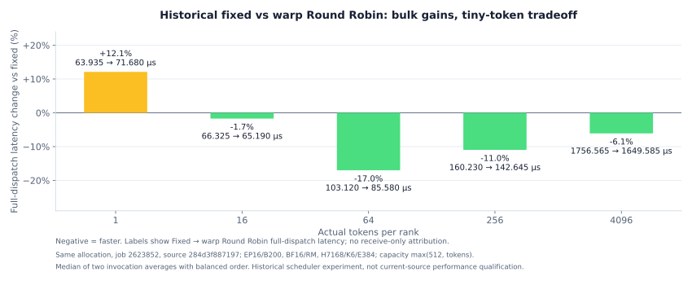

*Historical job 2623852, on `prenyx[0249,0258]`: EP16, LL/BF16/rank-major, H7168/K6/E384, FULL GIN, capacity max(512, tokens). Values are medians of two full-dispatch invocation averages, with balanced scheduler order on one allocation; all 49 study invocations, including the separate CTA-copy trial, validated. These are not receive-only timings or current-source performance qualification. The CTA-copy Round Robin variant was not promoted. Current receive selection is capacity-based, so a tiny active count on an eligible capacity-512 handle can still use Round Robin; the historical tiny-token penalty is not hidden by claiming a runtime fixed-receive cutoff.*

The launch code uses **`hierSelectRoundRobinReceive`** to select the JIT specialization from stable capacity and configuration. The kernel checks actual team dimensions, context availability, and task coverage before entering Round Robin; otherwise it uses fixed receive. **A small local send does not switch the receiver to a small-work schedule**: incoming traffic can still be large, and a capacity-512 rank sending Direct can use Round Robin to receive from hierarchical peers. The packet and completion protocol remains the same under either schedule.

*Current Round Robin eligibility covers EP16 with two eight-GPU LSA domains, BF16 rank-major hidden size 7168, top-k 6 or 8, capacity 64–8192, 384 logical CTAs, and unrestricted contexts relative to AUTO. These are capacity/configuration bounds, not a 64-token threshold on actual local sends. The fixed 384-CTA split above illustrates the alternative schedule; a qualifying capacity-512 configuration normally selects Round Robin.*

### 6. Consume relay publications as they arrive

Relay consumption and final extraction, described next, **can run concurrently or interleave** under the selected schedule; these headings do not introduce another phase barrier. For fixed receive, **`hierReceiveRelay`** discovers source control without blocking on an unavailable count, then calls **`hierDrainRelay`** for each potentially active remote producer. Its CTA leader polls through **`hierWaitRelayPublication`**. A source count can prune inactive producers, but discovering it must not prevent relay work that may itself be needed to publish that count. Direct completion or another relay's completed `done` also lets the worker skip a task without waiting for a GIN signal that will never land on this GPU.

The relay signal exposes **how many packets are published and whether the terminal has arrived**. On a new publication, **`hierBroadcastControl`** hands the leader's observation to the CTA through shared scratch and joins; every reader takes a snapshot before scratch can be reused. The CTA then calls **`hierForward`** for each newly available packet. That helper selects required local destinations, copies the ordinary header and payload with per-warp `UNROLLED_WARP_COPY` slices that load each value once for all destinations, and writes their full ready tags. The relay need not wait for the terminal to start forwarding: it drains the available prefix, polls for more, and retains the consumed-packet count.

In Round Robin, **`hierProbeReceiveTask`** performs the nonblocking probe in the task-owning lane. Once the warp selects a relay-ready task, **`warp.sync()`** hands that lane's acquired readiness to the other payload readers, and **`hierReceiveTaskRelay`** forwards one packet with the whole warp. Warp-private **`HierForwardScratch`** keeps its destination list independent of other warps. The owning lane updates the consumed count, allowing the warp to perform another ready task before returning to this one.

**Only after the terminal is observed and every published packet has been forwarded** does the responsible relay reset the indexed GIN signal with `net.resetSignal` and call **`hierPublishDone`** for all GPUs in the receiving LSA domain. Fixed receive publishes with the CTA; Round Robin publishes with the selected warp. The full-tag or sparse-count encoding is the same in both cases. An empty terminal skips payload copying but still completes the task; final `done` is never published merely because the first packet arrived. Polling retains the existing timeout checks.

### 7. Extract completed final slots into the output

Final extraction begins with **producer completion, not a speculative payload read**. In fixed receive, **`hierWaitDoneCount`** acquires send CTA 0's completion and discovers the source count; other active producers are checked separately through **`hierSendCtaComplete`**. The latter accepts relay/local completion or, for remote Direct, the packed completion together with the current full strong VA counter. A dense full-tag completion provides capacity as a safe scan bound rather than an exact count; current ready tags determine which slots actually contain live rows. Round Robin performs the same checks through **`hierProbeReceiveTask`**, then synchronizes and broadcasts the selected task's state before the copying warp reads payloads.

For a multi-token task, **`hierCopyFinalTokens`** has the 32 lanes probe different token slots belonging to that source/send-CTA producer. A ballot collects slots whose ready tag equals **epoch + 1**. The warp iterates the set bits: lane 0 reserves a compacted row with **`atomicAdd(outSrcInfo + sourceRank, 1)`**, broadcasts its index, and optionally increments the receive-rank counter. The row lies inside that source's rank-major output region. **`recordRankMajorRecvTokenMetadata`** records the original source token and expert/weight metadata, marking expert entries not owned by this GPU as −1. The whole warp copies the BF16 payload into `outDataBuf` (`recv_x`) with the inline `int4` loop. Row allocation can differ from original token order; the recorded source metadata preserves the association needed by combine.

For a source with exactly one token, **`hierCopyFinalSingleton`** checks its one candidate slot directly. Fixed receive assigns that singleton to one CTA and uses the whole CTA for payload copying, with warp 0 recording metadata; Round Robin uses its selected warp. A zero count copies no payload. Source-count discovery and per-producer completion pruning prevent nonexistent work from becoming an indefinite wait, while unused output top-k entries retain the −1 sentinel established earlier. Fixed workers join the CTA between source visits; Round Robin continues probing until its warp's relay and final tasks are all complete.

### 8. Retire the operation and advance the epoch

Every CTA finishes through **`completeFullLowLatencyEpochHier`**, regardless of receive schedule. First **`coop.sync()`** joins that CTA's payload and metadata readers. **Warp 0's leader reports one arrival with `atomicAdd`** on the current control bank's arrival counter; its result is broadcast within warp 0. CTAs that are not last need no terminal grid-wide wait. The last-arriving CTA—**not necessarily CTA 0**—has established that all CTAs have finished receive work and elects its warp 0 to perform cleanup.

The elected warp clears **only each source's send-CTA-zero `done` word**, distributing sources across lanes. At EP16, lanes 0–15 perform sixteen eight-byte stores: **128 bytes of sparse-count cleanup**, not a capacity-sized buffer wipe. Each writing lane executes **`memory_fence_release_sys()`**, then **`warp.sync()`** joins those writers. This bounds the lifetime of the packed 30-bit-epoch source counts, preventing dormant control words from aliasing after a long interval. Full ready tags, other full-width done tags, cumulative Direct VA counters, and sender-owned counter history remain intact.

Finally, the elected warp's leader resets the arrival counter and calls **`completeFullLowLatencyEpoch`** to increment the shared LL epoch. This helper performs the epoch update; the hierarchical wrapper established the reader join and cleanup ordering first. Kernel completion follows after the elected cleanup finishes. The output rows and metadata are then available under normal stream ordering, and the next matched LL operation selects its bank from the advanced epoch. This completes the fused dispatch walkthrough without adding a second grid-wide send/receive or retirement barrier.

## Performance: CollectiveX EP16 BF16

These plots use the November 4/5 Nyx study: **two B200 nodes, eight GPUs per LSA domain, BF16 rank-major LL, hidden size 7168, top-k 6, 384 experts, and uniform routing**. The metric is **measured round-trip p50 latency**, covering dispatch and combine, with 2048 samples per point; it is separate from the dispatch-only timings used earlier. Decode uses capacity 512 and CUDA graphs; prefill uses capacity 8192 without graphs. Both phases use NCCL-EP low-latency mode. “Normal” in the plot legends describes the resource budget.

### Unrestricted resources: clean comparisons first

The clean plots show the B200 baseline and **Dispatch-Hierarchical** variant with **148 SMs and an automatic requested QP budget**, alongside a red MoRI reference envelope. Green point labels measure latency gain against that MoRI envelope. For the matching B200 baseline comparison, decode round-trip latency falls from **498.688 to 387.072 µs at 256 tokens (22.4% lower)** and from **900.096 to 705.568 µs at 512 (21.6% lower)**. Small-token results stay closer to baseline. Prefill improves by **23.4–24.3%** across 1024–8192 tokens.

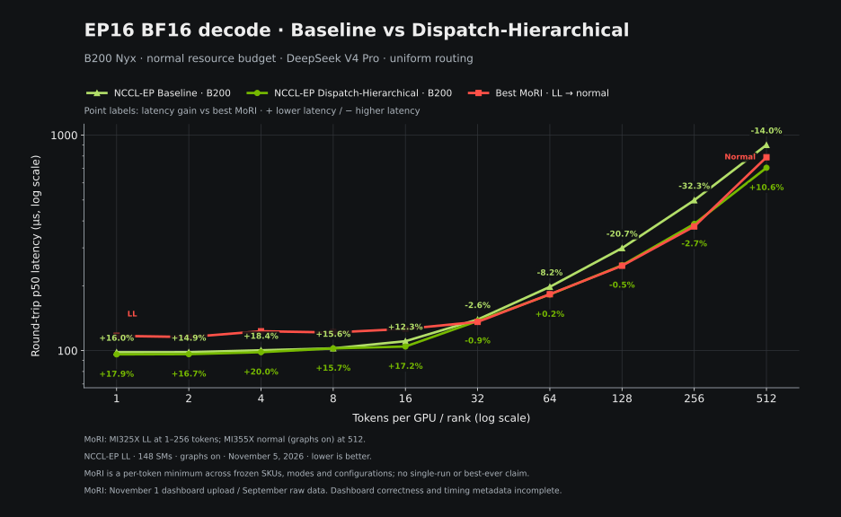

*Decode: graphs on, 1–512 tokens per rank. The red envelope uses MI325X MoRI LL through 256 tokens and MI355X MoRI normal with graphs on at 512. Point labels compare against the selected MoRI point; its hardware and mode can change.*

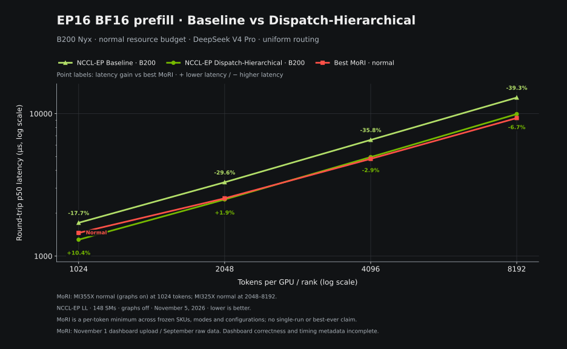

*Prefill: graphs off, 1024–8192 tokens per rank. The red envelope uses MI355X MoRI normal with graphs on at 1024 and MI325X MoRI normal at 2048–8192. These are comparisons of measured configurations, with hardware, mode, and graph differences visible; they do not isolate hardware speedup.*

### Include restricted resources: the limitation becomes visible

The full plots retain the unrestricted curves and add **32-SM, requested-QP=65** measurements, shown dashed. The limits apply to dispatch and combine, so this is a different resource regime, not an isolated QP-budget experiment. The Dispatch-Hierarchical variant regresses versus its matching restricted baseline from **16 decode tokens onward**: at 256 tokens, round-trip p50 rises from **525.312 to 880.608 µs (67.6% higher)**. Restricted prefill is **79.2–105.9% higher latency** across the four sizes. These results expose the reduced-SM weakness of the current selection model: a budget can be unrestricted relative to AUTO for 32 SMs while providing much less parallelism than the full-device calibration.

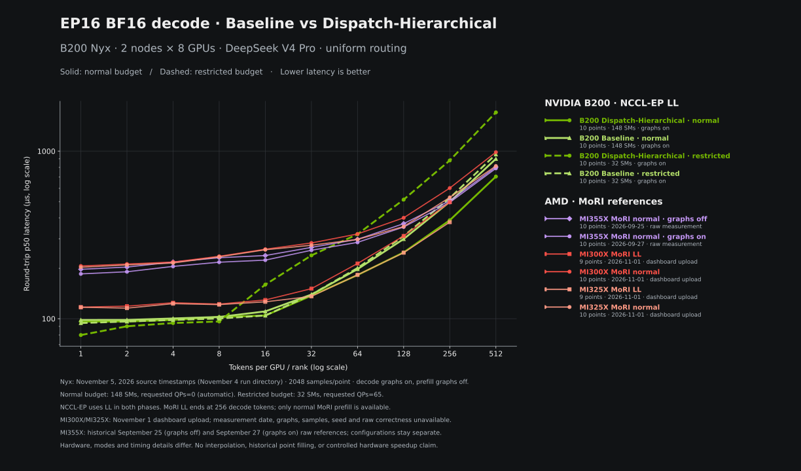

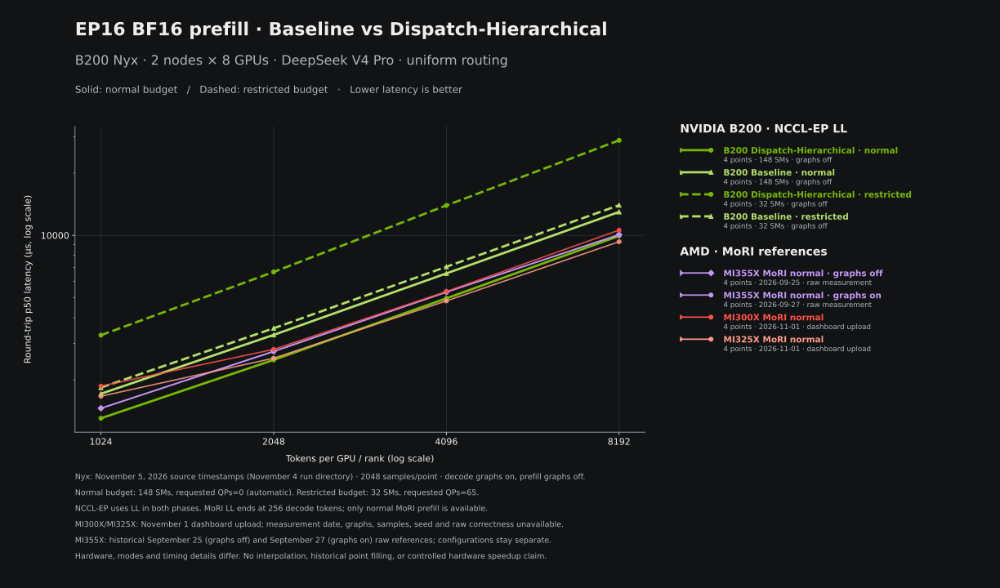

*The full plots keep MoRI SKUs, normal/LL modes, and known graph settings separately labeled. The clean red curve is instead a per-token minimum over those frozen candidates, not a single measured configuration or a same-mode ranking. MI300X/MI325X references are dashboard-reported and lack complete raw correctness, graph, sampling, and timing metadata; MI355X references are historical raw-validated September measurements. Missing points remain absent.*

### Measurement scope and provenance

The plotted measurements use CUDA 13.0 / PyTorch 2.11.0+cu130 and NCCL 2.32.6. All eight B200 cases succeeded with passing correctness/oracle checks, yielding **56 measured points**. These runs predate the final sparse-count cleanup and rebased NCCL dependency described in this PLC; they establish historical study performance, not a fresh qualification of the final source. “Dispatch-Hierarchical” is the display name for source variant `auto`; it includes the local Direct/hierarchical selection policy rather than implying every point used relay delivery. Requested QPs are configuration values, not a verified count of active hardware queues.

## Performance: ep_bench across 1, 2, 4, and 8 nodes

`ep_bench` now defaults to QP AUTO for all LL variants, rather than one context per local expert. Comparisons across revisions must use matching QP budgets instead of relying on the changed defaults; the paired results below use matching requested budgets.

The broader topology test asks whether **AUTO captures gains where hierarchy helps and retains baseline performance elsewhere**. This campaign uses **1, 2, 4, or 8 B200 nodes, eight GPUs per node and LSA domain** (EP8/16/32/64), BF16 rank-major LL, hidden size 7168, **top-k 8 and 256 experts**. Tokens equal capacity at every point. Here the metric is **full host-observed dispatch latency**, summarized as the median of two invocation averages per variant. It excludes combine and is not the CollectiveX round-trip p50 above.

### Unrestricted resources: gains and baseline retention

The parity line makes the desired behavior easy to inspect: **above 1× is a gain; below 1× is a regression**. At two nodes, AUTO reaches **2.06× at 512 tokens, 2.37× at 4096, and 2.27× at 8192**. Four nodes show smaller bulk gains, reaching **1.21× at 8192**. One-node AUTO retains baseline, as does the eight-node ladder; their bulk results stay near parity. These compare the complete AUTO policy against baseline, rather than forcing hierarchy at every topology or token count.

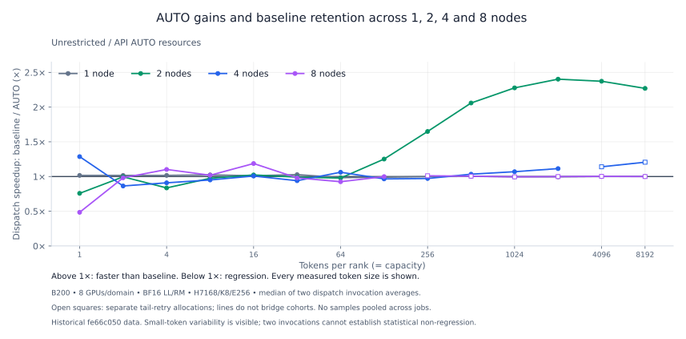

**This ladder does not establish “no regressions.”** Small-token measurements include slower AUTO points: two nodes at four tokens measure **0.84×**, four nodes at 32 tokens **0.94×**, and eight nodes at one token **0.48×**. Some repetitions vary widely—for that last point AUTO measured 366.68 and 194.25 µs versus baseline's 133.79 and 138.11 µs—even though AUTO retains the baseline family at eight nodes. Two invocations cannot separate all timing variability from policy overhead or establish statistical non-regression. These points remain visible; a stronger non-regression claim needs repeated, interleaved measurements.

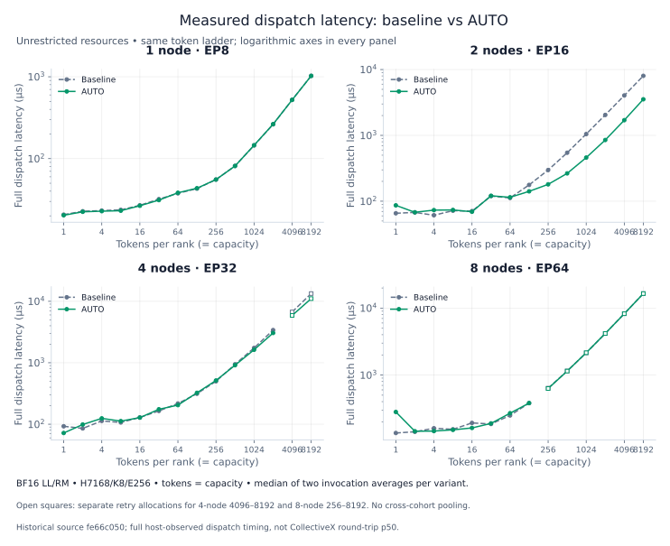

*Normal resources use API AUTO, with requested QP=0. Every plotted point pairs two valid baseline and two valid AUTO invocations from the same allocation. Open squares mark separate tail retries: four nodes at 4096–8192 tokens and eight nodes at 256–8192. Lines do not connect the original and retry cohorts, and their samples are never pooled.*

### Restricted resources: a separate limitation

With **32 SMs and requested QP=65 for both variants**, the same test exposes substantial regressions where AUTO promotes the new family. At 8192 tokens, speedup is only **0.35× for two nodes and 0.27× for four nodes**. One and eight nodes remain near parity in bulk. Together with the CollectiveX restricted results, this shows why the reduced-resource selection model still needs work before claiming gains without regressions across budgets.

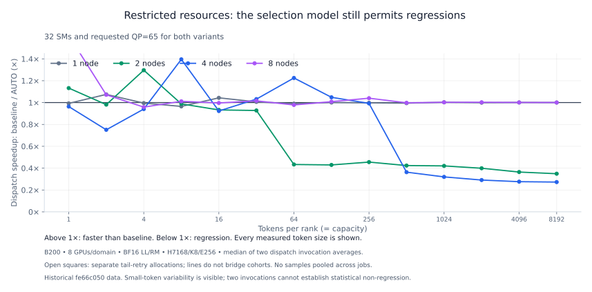

*These are historical measurements, before the final cleanup and dependency rebase, rather than a fresh qualification of the final source. Of 473 invocation records, 24 are invalid and one otherwise valid invocation has no complete matched group; the plots use 112 complete comparisons across both budgets.*
