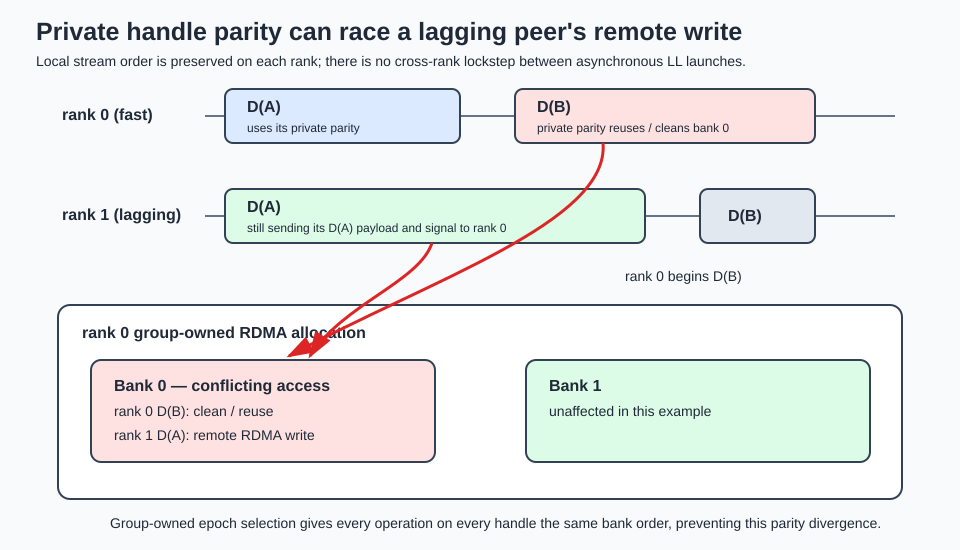
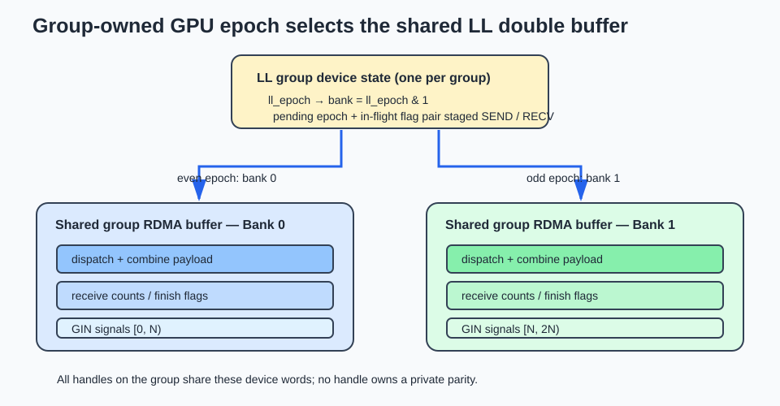

# Low-Latency Epoch Ticketing

## The contract this design restores

Low-latency communication has one double-buffered RDMA allocation per **group**, not per handle. Any operation using that group must therefore select its buffer bank from one group-wide order at GPU execution time.

The immediate execution that must be legal and correct is:

```text
Two handles on one group:       dispatch(A) -> dispatch(B) -> combine(A) -> combine(B)
```

The required bank sequence is:

| Execution order | 0 | 1 | 2 | 3 |
| --- | ---: | ---: | ---: | ---: |
| Logical epoch | E | E + 1 | E + 2 | E + 3 |
| Selected bank | `E & 1` | `(E + 1) & 1` | `E & 1` | `(E + 1) & 1` |

This proves that two handles cannot independently choose banks for shared group memory. It does **not** make independently captured CUDA Graph dispatch/combine executables safe to replay in arbitrary order; that release is a separate design effort.

## Failure before this change

The physical resources already belonged to the group: `handle->ll.layout` computed count and finish-flag offsets into `group->rdma_buffer`. The selector did not. `handle->ll.buffer_idx` was host state owned by an individual handle and was flipped by each dispatch or combine.

Consequently, identical LL handles computed the same offsets into the same two
banks but advanced different private parities. Calls on one rank are serialized
by the caller's stream, but ranks do not enter those calls in lockstep. A fast
rank can begin its next operation and clean/reuse a local bank while a lagging
peer is still remotely writing that bank for the peer's earlier operation. A
later poll can also consume a sibling signal: finish flags are the constant
`1`, and receive counts are workload determined. Dispatch receive counts and
combine finish flags share one offset
(`dispatch_rdma_recv_count_buffer_offset == combine_rdma_recv_flag_buffer_offset`),
so both paths were exposed.



Graph capture has the same ownership error in a different form. Capture baked a host-selected parity into the graph. Replaying a captured dispatch or combine did not advance the selector, even though it reused group-owned double-buffered resources.

### Observed symptom

With stock `nccl4py[cu13]==0.3.1`, GB200, four ranks on one tray, and otherwise identical work:

| LL handles on group | Result |
| ---: | --- |
| 1 | `rc=0`; no receive timeouts; combine correctness passes |
| 2 | 64 dispatch and 6 combine receive timeouts, then error 719 |

The visible failure was NCCL EP dispatch/combine receive-timeout warnings followed by `trap()` and `cudaErrorLaunchFailure (719)`. `ep_bench` creates one handle, so it stays green through eight configurations and 20,000 iterations, including without its per-iteration MPI barrier, with a 500 ms rank stall, and with dispatch-only or combine-only loops. A multi-handle benchmark fails almost immediately on x86 H100, B200, and B300 as well; this is not GB200, GB300, or MNNVL specific.

The TensorRT-LLM CUDA Graph replay regression is related validation that replay must consume state written after capture: https://github.com/NVIDIA/TensorRT-LLM/blob/main/tests/unittest/_torch/modules/moe/test_moe_comm.py

## Requirements

- Select the bank on the GPU at execution time; no host counter.
- Give every LL operation on a group one total bank-selection order, independent of handle.
- Keep payload, metadata, cleanup, and GIN signals on the selected bank together.
- Reuse the existing full-operation grid synchronization; staged RECV-only needs no additional barrier.
- Support one staged SEND-only / RECV-only operation with an explicit in-flight check.
- Preserve the existing two-bank allocation with a compact footprint.

## Design

### Group-owned device epoch

Each LL group owns three 32-bit device words:

```c++
unsigned int* ll_epoch;           // starts at 0
unsigned int* ll_pending_epoch;   // saved epoch of a staged operation
unsigned int* ll_send_in_flight;  // 0 = idle, 1 = SEND-only is awaiting RECV-only
```

For a full operation, CTA 0 first verifies that no staged operation is in
flight (`*ll_send_in_flight == 0`). Every CTA reads `*ll_epoch` into a local
value before the existing grid synchronization. All payload, metadata,
cleanup, and GIN addresses for that operation derive from this locally retained
value. The existing synchronization already guarantees that every CTA has
reached this point of the full LL operation. Immediately after it, CTA 0
increments `ll_epoch` once for the next operation:

```c++
if (blockIdx.x == 0 && threadIdx.x == 0)
    EP_DEVICE_ASSERT(*ll_send_in_flight == 0);
const unsigned int operation_epoch = *ll_epoch;
const size_t bank = operation_epoch & 1U;

// Existing full-operation grid synchronization.
cg::this_grid().sync();
if (blockIdx.x == 0 && threadIdx.x == 0) {
    ++*ll_epoch;
}
```

No synchronization after the increment is required: every CTA in the current
kernel has already retained `operation_epoch`, and the following operation is
ordered after this kernel. Dispatch and combine may use different CTA counts;
the protocol does not count CTAs or depend on the grid size.

Every resource address is derived from the same epoch bit:

```c++
const size_t bank = operation_epoch & 1U;
const size_t send_off = send_off_base + bank * payload_slot_stride;
const size_t recv_off = recv_off_base + bank * payload_slot_stride;
void* const send_buf = static_cast<char*>(rdma_buf) + send_off;
void* const recv_buf = static_cast<char*>(rdma_buf) + recv_off;
signal_base += bank * num_experts;
```

There is no handle-private parity, descriptor table, host counter, ticket
atomic, or extra grid-wide publication barrier.

### Staged SEND-only / RECV-only completion

A staged operation must use the same bank for both of its phases. SEND-only
therefore verifies that no staged operation is already in flight, reads the
current `ll_epoch`, and does **not** advance it. CTA 0 saves that epoch, then
marks the staged operation in flight:

```c++
// SEND-only: all CTAs derive addresses from E.
if (blockIdx.x == 0 && threadIdx.x == 0) {
    EP_DEVICE_ASSERT(*ll_send_in_flight == 0);
    *ll_pending_epoch = *ll_epoch;
    *ll_send_in_flight = 1;
}
const unsigned int operation_epoch = *ll_epoch;
```

RECV-only uses `ll_pending_epoch`, rather than `ll_epoch`, as its operation
epoch. CTA 0 verifies that a staged operation is in flight and that the saved
epoch matches the current epoch. CTA 0 may then advance `ll_epoch` and clear
the in-flight flag without a grid barrier: every RECV-only CTA derives its
addresses from the immutable pending epoch, and no CTA reads the flag:

```c++
// RECV-only: all CTAs derive addresses from the pending E.
const unsigned int operation_epoch = *ll_pending_epoch;
if (blockIdx.x == 0 && threadIdx.x == 0)
    EP_DEVICE_ASSERT(*ll_send_in_flight == 1 && operation_epoch == *ll_epoch);
if (blockIdx.x == 0 && threadIdx.x == 0) {
    ++*ll_epoch;
    *ll_send_in_flight = 0;
}
```

`ll_pending_epoch` is not cleared; it is overwritten only by the next
SEND-only operation. The distinct in-flight flag makes the stale value
unambiguous and provides the misuse check. Since RECV-only CTAs read only the
pending epoch, CTA 0 can safely clear the flag without waiting for all CTAs.

**Required ordering:** no later LL operation may start on the group until the
matching RECV-only completion has finished. The existing contract must enforce
this through same-stream ordering or explicit user synchronization. Without
that condition, a later operation could observe or advance the group epoch
while the split operation still uses bank `E`. The device assertions make a
second SEND-only, a full operation, or a RECV-only without a matching SEND-only
fail fast instead of silently overwriting the group state.

### Why this is sufficient

1. **Shared ownership matches shared selection.** Every handle on a group reads and advances the same device epoch, so private handle state cannot select a conflicting bank.
2. **One operation receives one bank.** All CTAs retain the pre-barrier epoch, and payload, count/flag, cleanup, and GIN signal addressing all derive from `epoch & 1`.
3. **The chain above maps correctly.** The first and third operations select the same bank, and the second and fourth select the other bank. Thus `D(A), D(B), C(A), C(B)` retains the intended double-buffer pairing.
4. **Variable CTA counts are irrelevant.** The existing grid barrier establishes the handoff; no arrival radix or completion accounting is needed.
5. **Staged phases stay paired.** `ll_send_in_flight` represents the one staged operation in flight, while `ll_pending_epoch` preserves its `E`. RECV-only uses that saved `E` and safely advances only the live epoch.

### Resource cleanup and signal lifecycle

The two banks are reusable state, but not all of their storage has the same cleanup rule:

| Resource | Reset point | Why it is safe with epoch banking |
| --- | --- | --- |
| Dispatch GIN count signal | The receiving dispatch kernel resets it immediately after observing the count. | The signal ID includes the epoch-selected bank and source rank. That bank is not reused until two later operations. |
| Combine GIN finish signal | The receiving combine kernel resets it immediately after observing the finish flag. | The signal ID includes the same epoch-selected bank as its receive-flag buffer. |
| RDMA receive count / finish-flag memory | The SEND phase zeros the opposite bank before that bank is reused. | The current operation is already complete with respect to that metadata before the alternating bank is prepared. |
| Payload memory | Not zeroed. | The receiver reads it only after the current bank signal/count authorizes it; valid producer regions are overwritten. |
| `ll_epoch` | Initialized to 0 at group creation; incremented once per full LL operation or matching RECV-only completion. | It encodes the monotonic group operation order; normal unsigned wrap preserves bank alternation. |
| `ll_pending_epoch` | Written by SEND-only and read by its matching RECV-only; stale while idle. | It selects the split operation's bank even while CTA 0 advances `ll_epoch`. |
| `ll_send_in_flight` | `0` when idle; SEND-only sets it to `1`, and matching RECV-only resets it to `0`. | It distinguishes a valid saved epoch of zero from stale pending data and detects invalid staged ordering. |

GIN reset is required: the waits accept a value of at least one, so a stale signal would otherwise make a reused bank appear complete. The cleanup barrier used by `ncclEpMaskClean` has its own signal ID at `2 * N`, outside bank 0 `[0, N)` and bank 1 `[N, 2N)`. `ncclEpMaskClean` clears both RDMA metadata banks; normal receive and timeout paths clear the data GIN signals. Recovery after a masked timeout still relies on the existing quiescence contract before ranks are re-enabled.



## Impact

- Makes the existing LL double buffer safe across handles for full and staged LL operations.
- Reuses an existing grid barrier for full operations; staged RECV-only uses no additional barrier, per-CTA atomic, or CTA accounting.
- 12 bytes of persistent device state per group; no RDMA-buffer growth.
- The prior controlled six-trial intra-node EM128 experiment measured +2.4% total latency versus `origin/main`; rerun the compact implementation in that harness before publishing a final regression number.

## Validation

### Protocol unit test

Replace the ticket-protocol unit test with coverage for the simple epoch
increment: consecutive full operations alternate banks, arbitrary dispatch and
combine CTA counts do not affect that alternation, and unsigned rollover
preserves parity while the nonzero epoch range is in use. It must also cover
SEND-only followed by RECV-only: both phases use the same pending epoch,
RECV-only clears the in-flight flag while advancing the live epoch, and only
RECV-only advances the group epoch. It must also validate normal 32-bit epoch
rollover. CUDA Graph replay remains outside this change's validation scope.

### Four-rank group regression

`test_ll_group_epoch` first uses two handles with disjoint A/B values and validates dispatched buffers plus identity-combine outputs for both chains:

```text
dispatch(A) -> combine(A) -> dispatch(B) -> combine(B)
dispatch(A) -> dispatch(B) -> combine(A) -> combine(B)
```

It must validate the two-handle group-resource collision. CUDA Graph replay
is outside this full-operation protocol's scope.

### Two-node RDMA validation

Validate with two ranks on each of two nodes, setting
`NCCL_MNNVL_CLIQUE_ID=$SLURM_NODEID` per rank. This prevents the nodes from
forming one MNNVL clique and forces the cross-node RDMA/GIN path while
preserving the two-handle sequence.

```text
NCCL_MNNVL_CLIQUE_ID=$SLURM_NODEID \
  srun --nodes=2 --ntasks-per-node=2 ... test_ll_group_epoch
```
