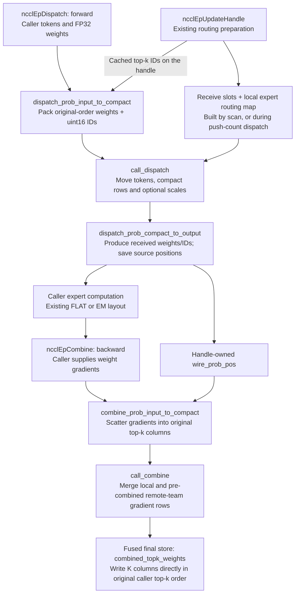

# MR171: HT Compact Top-k Weights and IDs

## Where this helps

HT EP sends a token's gating weights to the ranks that own its selected
experts. The dense format reserves one FP32 value for every expert in the
destination LSA team, although a token selects only `top_k` experts.

When the complete compact row is smaller than the dense row and expert IDs
fit in uint16, push-based forward dispatch automatically sends the
token's original-order weights and matching expert IDs together in a smaller
payload. It does not sort those weights or exchange an additional top-k table.
Backward combine returns FP32 gradients in the same original top-k order.
It reuses the positions found during forward dispatch, so it does not
send IDs again, sort gradients, or reduce integer IDs as floating-point values.

For example, a team with 256 experts needs a 1024-byte dense weight row.
At top-k 8, forward dispatch instead sends 48 bytes: 32 bytes of weights
and 16 bytes of IDs. Backward combine uses 32 bytes of gradients.

The caller's tensor formats do not change. Gating weights stay FP32 even
when activations use MXFP8. This is packing, not quantization. Forward
combine and backward dispatch have no separate probability payload and
are unchanged.

An LSA team is a group of ranks that can directly access one another's GPU
memory, typically over NVLink. It is not one rank and need not be one
physical node.

See [MR171](https://gitlab-master.nvidia.com/nccl/nccl-extensions/-/merge_requests/171)
for the Dispatch before/after measurements and their timing boundaries.

## High-level flow

There are three stages for push-based dispatch. Routing preparation happens
during `ncclEpUpdateHandle`, after `ncclEpInitHandle` initializes the handle.
Forward dispatch and backward combine reuse that handle. The convenience
`ncclEpCreateHandle` API combines initialization and the first update.



These adapter names describe internal functions; the public dispatch/combine
API names and tensor formats do not change. Existing EM duplication/permute
and gather/reduce stages remain in place around the corresponding transfers.
The diagram shows compact push paths; dense fallback and pull-push are
described below.

Dense forward dispatch already runs `sparse_to_dense_prob` before communication
and `dense_to_sparse_prob` after it. The two compact dispatch adapters replace
those conversion kernels. Total Dispatch timing includes the corresponding
input and output conversions in both implementations.

| Stage | What changes |
|---|---|
| Routing preparation | No new AllGather or scan output; reuse the existing local expert routing map |
| Forward input/output adapters | Pack weights with IDs; decode received weights and save their original top-k positions |
| Forward communication | Use the compact row's byte count and token-scoped strides |
| Backward input adapter and final reduction | Use saved positions to scatter gradients; write K output columns directly from the final reduction |
| Backward communication | Keep the existing addition, but merge disjoint expert contributions into one original-order row instead of separate team blocks |

### Buffer ownership and NVLink/RDMA flow

```text
FWD-DISPATCH: original token rank -> expert rank

[caller] topk_weights[tok,K] + [handle] cached topk_idx[tok,K]
                 |
                 | dispatch_prob_input_to_compact
                 v
[group] prob_buffer: [K FP32 weights | K uint16 IDs | pad to 16B alignment]
        Rebuilt each dispatch; registered in gin_base_ptr across LSA teams,
        or a group-owned standalone allocation for one LSA team.
                 |
          +------+---------------------------------------+
          | same LSA team (NVLink)                       | other LSA team (RDMA/GIN)
          v                                              v
    G2S: load into SMEM                          N2N: net.put from nccl_prob_window
          |                                              |
          |                                     [remote group] gin_recv_staging
          |                                              |
          |                                     G2S: load into SMEM
          +----------------------+-----------------------+
                                 |
                        S2G: NVLink peer store
                                 v
[group] dispatch_expert_output_prob_buffer_ptrs[lsa_rank]
                                 |
                      dispatch_prob_compact_to_output
                                 |
                 +---------------+----------------------+
                 v                                      v
[caller] FLAT weights/IDs                  [handle] wire_prob_pos
         or EM local-permute scratch               Original top-k columns;
                 |                                 survives interleaved handles.
         Existing duplication / permutation
                 v
[caller] EM weights in their expert zones
```

```text
BWD-COMBINE: expert rank -> original token rank

[caller] dL/dw in the receive layout
                 |
         EM local-permute: gather with the saved flat2em_slot_map
                 |
         combine_prob_input_to_compact + [handle] wire_prob_pos
                 v
[group] combine_expert_input_prob_buffer_ptrs[lsa_rank]
        Zeroed/scattered FP32 rows, K4 = round_up(K,4); no IDs.
                 |
          +------+--------------------------------------+
          | same LSA team (NVLink)                      | other LSA team (RDMA/GIN)
          v                                             v
    Read local peer staging                    combine_gin_RED_prob / G2S_prob
          |                                    Pre-combined remote-team K4 rows
          +----------------------+----------------------+
                                 |
                      Final FP32 reduction
                      Store K columns directly (fused)
                                 v
[caller] combined_topk_weights[tok,K] in original top-k order
```

Dispatch packing remains separate because the RDMA sender reads a registered
global probability window, while the NVLink producer loads rows into shared
memory. Packing only into that producer's shared-memory stage would not supply
the RDMA sender. A future dispatch fusion needs to preserve both producers'
staging and visibility rules. The receive decoder also persists positions for
backward while retaining the existing receive order used by EM permutation.

Backward combine's final conversion was only an aligned-row-to-K copy, so it
is fused into the existing final reduction. Intermediate RDMA/NVLink rows keep
their aligned K4 stride. Only the final caller store changes, and it supports
unaligned row sizes such as K10 without a separate output kernel.

### 1. Prepare routing

The existing routing mode determines when receiver metadata is built:

```text
Bitmap / scan modes
  UpdateHandle
    top-k IDs -> routing bitmap -> existing AllGather -> FLAT / EM scan
                                                       |
                                                       +-> receive slots
                                                       +-> local expert map

EM push-count mode
  UpdateHandle
    top-k IDs -> existing count / source-routing preparation
                           |
  Forward dispatch         v
    existing count exchange + payload movement
      -> receive slots + packed local expert map
      -> decode inline IDs and save original top-k positions
```

The local expert routing map tells a receive slot which local experts it
belongs to. Routing preparation is unchanged by the compact format: it
does not compute weight positions or compact offsets. Both scan and
push-count modes save the positions while decoding forward weights.

The forward weight format adds no ordered-ID AllGather. IDs travel with
weights in the probability payload shown next.

### 2. Forward dispatch: original token rank to expert ranks

```text
Caller inputs for one token
  token + top-k IDs + FP32 weights in the caller's order
                        |
                        v
  dispatch_prob_input_to_compact:
    [K FP32 weights | K uint16 expert IDs | alignment padding]
                        |
                        v
  call_dispatch (existing dispatch transfers):
    token + packed weight/ID row + optional activation scales
                        |
                        v
  dispatch_prob_compact_to_output uses the local expert routing map:
    visit this slot's local experts in ascending order
    find each expert's original top-k position in the inline IDs
    pack matching IDs and weights at the beginning of the output row
    save each original top-k position with the handle for backward combine
                        |
                        v
  Unchanged public output
    FLAT: local selected IDs/weights, with padding
    EM:   one weight per token-expert slot
```

Every destination receives the same original-order weight/ID row for that
token. This is not a selective-weight format that sends only each
destination's weights. The IDs share the existing probability byte copy;
they do not introduce a separate copy request.

### 3. Backward combine: expert ranks to original token rank

```text
Caller supplies dL/dw in the public receive layout
                        |
                        v
  combine_prob_input_to_compact:
    use saved positions to fill a zeroed K4 row
    columns follow the caller's original top-k order
    K4 = round_up(K, 4)
                        |
                        v
  call_combine: local / remote-team reductions merge FP32 rows
    final reduction writes the K caller columns directly
    wire staging remains K4-wide; output stores omit alignment padding
                        |
                        v
  Unchanged combined_topk_weights
```

Forward and backward agree on the original top-k column order. Only
forward carries IDs: the receiver saves the positions once, then backward
adds FP32 gradient rows without needing IDs on the wire. ID bit patterns
must never enter a floating-point reduction.

The separate pull-push implementation already handles sparse weights
directly. It does not use the new packed probability row; see
[Pull-push and existing packed top-k metadata](#pull-push-and-existing-packed-top-k-metadata).

## Forward example: original wire order, existing receive order

Suppose a token selects experts in this order and rank 0 owns experts 0–3:

```text
Caller top-k IDs:     [ 9,  2,  8,  0]
Caller weights:      [w9, w2, w8, w0]

Forward wire row:
  weights:           [w9, w2, w8, w0]
  matching IDs:      [ 9,  2,  8,  0]
  alignment padding follows
```

The decoder retains the existing ascending local-expert receive order.
Experts 0 and 2 are found at original top-k positions 3 and 1:

```text
FLAT receive slot on rank 0
  recv_topk_idx:      [ 0,  2, -1, -1]  // global-ID output shown
  recv_topk_weights:  [w0, w2,  0,  0]
  saved wire_prob_pos:[ 3,  1,  x,  x]  // x = invalid position

EM receive layout on rank 0
  expert-0 token slot: w0; saved source position 3
  expert-2 token slot: w2; saved source position 1
```

Valid FLAT entries form a packed prefix; the remaining columns have ID `-1`
and weight zero. LOCAL output subtracts the rank's global expert offset.
Compact and dense paths retain the same ascending expert order and
packed-prefix behavior. The wire row itself remains in the caller's original
top-k order; receive ordering does not sort or change that row.

The decoder visits local experts and searches the inline top-k IDs for each
LERM hit: matching work is O(experts_per_rank + hits * K). It checks LERM
before reading payload, so unwritten EM padding is not searched.

Local-permute EM retains its existing ascending-order FLAT-to-EM mapping.
Weights and saved source positions use that same order. Backward combine
uses the persisted map to gather gradients into FLAT columns, then scatters
them through `wire_prob_pos` into the caller's original top-k order.

### Payload layout and bounds

Let `K = top_k` and `D = experts_per_rank * lsa_team_size`.

```text
Dense probability bytes per token:   4 * D
Compact forward bytes per token:     round_up(6 * K, 16)
Compact backward bytes per token:    4 * round_up(K, 4)
```

The forward row is one 16-byte-aligned byte record. Its weight and ID
sections are not independently rounded up:

| Top-k | FP32 weights | uint16 IDs | Final padding | Forward row | Backward row |
|---:|---:|---:|---:|---:|---:|
| 8 | 32 B | 16 B | 0 B | 48 B | 32 B |
| 10 | 40 B | 20 B | 4 B | 64 B | 48 B |

IDs use `0xffff` for an invalid entry; valid IDs range from 0 to 65534.
The packer checks IDs in their original signed width before converting to
uint16, so a large invalid ID cannot alias a real expert after narrowing.
Invalid entries get zero weights, and the packer writes the entire row,
including padding, without a separate forward clear. The normal routing
contract still requires distinct valid top-k IDs, with `-1` padding; this
packing check is not a new guarantee for arbitrary invalid routing inputs.

Probability buffers retain their existing allocation capacity. Actual
dispatch strides, shared-memory staging and transfer byte counts use the
smaller forward payload width. A dense-sized allocation does not mean
dense-sized data is transmitted. Although transport interfaces express
some sizes in float words, the ID tail is copied as bits, never processed
as floating-point numbers.

## Backward example: one FP32 column per selected expert

Use the same source IDs `[9,2,8,0]`. Both legs use those same columns:

```text
Expert represented:        9    2    8    0
Rank owning 0 and 2:     [ 0,  g2,   0,  g0]
Rank owning 8 and 9:     [g9,   0,  g8,   0]
                         -------------------
Merged compact row:     [g9,  g2,  g8,  g0]

Already in caller order [9,2,8,0]:
combined_topk_weights =  [g9,  g2,  g8,  g0]
```

Each expert has one owner, so these contributions fill disjoint columns.
Ranks within a remote LSA team first consolidate their contributions;
the original token rank then merges local and remote-team compact rows.
The existing gradient addition is retained.

Intermediate reduction/transport rows are **2-D arrays**: `[source_token][K4]`.
The final reduction writes public `combined_topk_weights[source_token][K]`
directly, using FP32 stores bounded by K and the live token count. Dense mode
uses `[source_token][D * LSA_TEAMS]` internally, with the second dimension divided
into one expert block per team. Compact does not retain a separate K4
block for every team.

### Saved positions: wire_prob_pos

Backward combine follows a forward dispatch on the same routing handle.
The forward decoder saves the original top-k position for every returned
expert weight. Backward uses that map directly:

```text
Rank 0, FLAT receive slot:
  backward input:       [g2, g0,  0,  0]
  saved positions:      [ 1,  3,  x,  x]
                          |   |
  compact gradient row: [ 0, g2,  0, g0]
```

| Receive layout | Saved map shape | Backward use |
|---|---|---|
| FLAT | `[recv_slot][K]` | Scatter each live input column to its saved original-k column |
| Native EM | `[recv_slot]` | Scatter the slot's one gradient to its saved column |
| Local-permute EM | `[flat_scratch_slot][K]` | Unpermute EM gradients into the existing FLAT scratch, then use its saved map |

For K up to 255, each position occupies one byte; `255` marks unused
entries. Larger K uses two bytes per position with `65535` as the unused
value. Thus K=8 needs 8 map bytes per FLAT receive slot, or 1 byte per
native EM slot. This metadata is local: it is not another wire payload.

The map belongs to the handle, not the group's reusable probability
buffer. Dispatching handle B cannot overwrite the saved positions needed
by handle A's backward combine. After changing routing with UpdateHandle,
the next forward dispatch writes the new positions.
Allocation covers the configured receive capacity, not just active rows.
UpdateHandle initializes the map to all-ones alongside its existing S2D
map clear, so unused capacity cannot retain stale positions; this adds
bytes to the existing clear, not another kernel launch.

There is no sorted-gradient offset or bitmap popcount step. The backward
adapter reads the saved positions and gradients; it does not scan local
experts or search the source top-k IDs again.

The internal compact gradient row must be zero outside the owned expert
columns. The adapter skips invalid map entries before reading caller
padding gradients, which need not be zero. The internal row's initialization
remains separate from the forward packer's fully-written byte row. Compact
combine needs no final output clear: every live output column is written by
the reduction, including zeros for columns with no contribution.

## Pull-push and existing packed top-k metadata

[EM pull-push](../ht-em-pull-push/README.md) already reads source weights
from sparse top-k rows. Its `srcpos_map` records the original top-k
position for each local expert hit, so it does not need another inline-ID
payload or the new forward pack/decode adapters.

[Pull-count dispatch](../ht-em-dispatch-pull-count-exchange/README.md)
uses the same information when map construction moves into dispatch:

```text
Existing pull-count path
  UpdateHandle
    snapshot packed top-k IDs + prepare counts
                          |
  Forward dispatch        v
    push existing top-k metadata to receivers
      -> build recv_slot_to_src, flat2em_slot_map and srcpos_map
      -> pull the source token and its sparse weight row
      -> select weights using srcpos_map
                          |
  Backward combine        v
    use the saved source positions to return sparse weight gradients
```

For `[0,8,9,2]`, rank 0's local hits 0 and 2 use source positions 0 and 3.
Those positions already identify `w0` and `w2`; sending another copy of
the IDs with the weights would be redundant.

The scan-based pull-push path AllGathers packed top-k before building
maps; pull-count delivers the packed top-k through its existing dispatch
metadata path. Neither is converted into a dense weight path by automatic
format selection. The common selector returns the non-compact enum for
pull-push only to bypass these probability-buffer adapters: the actual
pull-push payload remains sparse-direct.

This distinction also matters for EM push-count: its packed local expert
routing map identifies local membership, but does not contain the source
token's original top-k permutation. That push-based path still needs the
inline IDs to decode an original-order weight row.

## Automatic selection and impact

No environment variable is required. The library selects the wire format
from the handle's top-k and the group's expert/LSA-team geometry.

Push-based paths fall back to dense when the **whole** forward payload
(weights, IDs and padding) is not smaller than the dense team row, or
when the global expert count exceeds 65535. Pull-push keeps its existing
sparse-direct behavior.

```text
Pull-push?                         -> existing sparse-direct path
Global expert count > 65535?       -> dense push path
round_up(6 * K, 16) >= 4 * D?       -> dense push path
Otherwise                         -> compact push path

D = experts_per_rank * lsa_team_size, not experts per physical node
```

The intended benefit is less probability data movement without forward
weight sorting or an additional ordered-ID exchange. The cost is carrying
IDs and selecting local experts in one pass over them at the receiver. This design
does not claim that fewer bytes always make dispatch faster; the
receiver work, token size and transport also matter. Saving positions
adds small handle-owned metadata writes during forward decode; backward
uses those positions instead of sorting, scanning local experts, or
searching source IDs to restore output order.

| Source area | Responsibility |
|---|---|
| `nccl_ep.cc` | Mode selection, per-handle position maps, runtime widths and pull-push bypass |
| `ht_compact_prob.h` | Weight/ID byte layout, alignment and representation bounds |
| `device/ht_ep_adapter.cu` | Original-order forward pack/decode and FP32 backward adapters |
| `device/ht_ep.cuh` | Runtime transfer/staging widths and compact gradient reductions |
| `tests/test_ht_compact_prob.cu` | End-to-end forward/backward coverage and automatic dense fallback |
