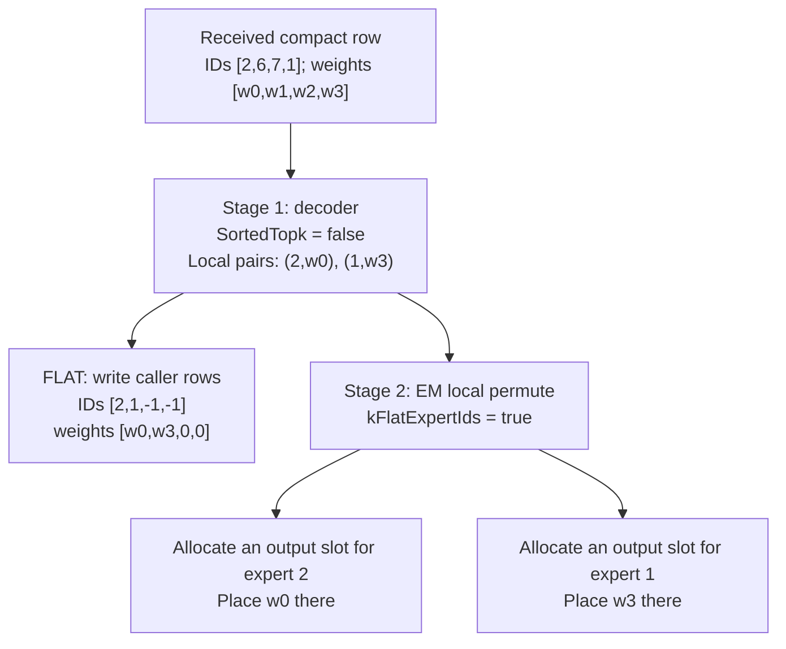

# MR289: Gapless source top-k order for HT compact receivers

HT compact push dispatch walks source top-k IDs once and packs local matches
at the beginning of each output row. IDs, weights, and saved source columns stay
paired. `NCCL_EP_HT_RECV_TOPK_ORDER=source-compact` (default) preserves source
top-k order without gaps; `expert-ascend` restores ascending expert order, also
without gaps. Set the option before group creation. Values are case-insensitive.
Unset or empty selects `source-compact`; invalid values produce a warning and
use the default.

## Decoder and output stages

For input IDs `[2,6,7,1]`, caller weights `[w0,w1,w2,w3]` indexed by
original source column, and rank 0 owning experts 0–3 (local matches 1 and 2):

| Mode | Global IDs | Local IDs | Weights | Saved source columns |
|---|---|---|---|---|
| `source-compact` (default) | `[2,1,-1,-1]` | `[2,1,-1,-1]` | `[w0,w3,0,0]` | `[0,3,invalid,invalid]` |
| `expert-ascend` (fallback) | `[1,2,-1,-1]` | `[1,2,-1,-1]` | `[w3,w0,0,0]` | `[3,0,invalid,invalid]` |

FLAT and EM local-permute (EM-LP) both reconstruct local ID/weight pairs from
the received compact row. For FLAT, the decoder writes the reconstructed
`recv_topk_weights` and `recv_topk_idx` into the caller's buffers. For EM-LP,
it writes intermediate rows that the permutation moves into expert-major slots.
For EM-LP, the rows in the table describe intermediate data, not public output
ID rows: each final EM output row belongs to one expert and holds one weight.



### Stage 1: decoder

In [compact_prob_to_output](../../../device/ht_compact_prob.cuh#L56),
`SortedTopk = false` scans the source top-k IDs once, selecting local matches
in their original relative order. It produces `(2,w0)` followed by `(1,w3)`
and pads the tail with `-1` IDs and zero weights. The saved source columns
`[0,3,invalid,invalid]` retain the association needed for backward gradients.
`SortedTopk = true` restores the ascending-expert traversal.

### Stage 2: EM local permute

In [local_permute_dup](../../../device/ht_ep.cuh#L6568),
`kFlatExpertIds = true` consumes the explicit local expert IDs from Stage 1.
For each decoded column, it allocates an output slot for that expert and
places the corresponding weight there: expert 2 receives `w0`, and expert 1
receives `w3`. The decoded IDs temporarily occupy the handle-owned
`flat2em_slot_map`; the permutation replaces each ID with its EM slot in the
same column. Backward operations reuse that persisted slot map.

The stages must agree on the same `(expert ID, weight)` pairing. Once the
decoder stops producing ascending expert order, the permutation cannot infer
the expert from an ascending position: doing so here would send `w0` to expert
1 and `w3` to expert 2. The new path uses the decoded IDs to preserve the pairing.
Both flags select JIT specializations rather than per-element runtime branches.

The new source-order path rebuilds the EM slot map during each forward EM-LP
Dispatch, including AllGather + scan. It resets per-expert cursors and performs slot
allocation atomics inside the existing permutation kernel. This adds work over
reusing the scan's earlier map and can offset decoder savings. Count mode already
built its map during Dispatch. FLAT does not perform this EM map rebuild.

### FLAT code path

FLAT uses the same one-pass decoder and exposes the changed order directly.
It still reconstructs the weight row: `weights[output] = row[source_k]` gathers
the selected wire weight into the next packed output column. In the example,
source columns 0 and 3 become `[w0,w3,0,0]`. FLAT skips only the subsequent
EM permutation, not this reconstruction:

```text
ncclEpDispatch (FLAT, compact forward push)
  em_permute_active = false; dsp_em = false
  dsp_topk_weights -> caller recv_topk_weights
  dsp_topk_idx     -> caller recv_topk_idx
  dispatch_prob_compact_to_output(..., flat_expert_ids = nullptr, ...)
    launch_compact_prob_output(..., sorted_topk = false, ...)
      compact_prob_to_output<PosT, false>
        emit local matches into caller IDs/weights and save source columns
        pad the unused columns with -1/0
  skip the EM local-permute block
```

The [layout guard](../../../nccl_ep.cc#L3251) enables EM permutation only for
expert-major layouts. [Dispatch output selection and launch](../../../nccl_ep.cc#L5912)
therefore pass the caller's FLAT buffers directly to the decoder.
The [adapter](../../../device/ht_ep_adapter.cu#L541) selects the ordering variant;
the decoder's [emit operation](../../../device/ht_compact_prob.cuh#L80) writes
the paired IDs/weights into those buffers. The later
[EM permutation guard](../../../nccl_ep.cc#L5960) is false for FLAT.

### Other EM paths

EM is an output layout, not a single implementation. The
[HT EM modes](../../../nccl_ep.cc#L836) have different weight paths:

| HT EM mode | Weight path |
|---|---|
| `local_permute` | Stage 1 reconstructs intermediate FLAT weights; Stage 2 places them into EM slots. |
| `nvlink_dup` / `local_dup` | With compact selected, Stage 1 uses `expert_major = true` and reconstructs final EM weights, one per expert/token slot. These modes have their own token duplication and do not use the EM-LP permutation. |
| `pull_push` | Uses its separate sparse-weight pull path, bypassing this compact decoder. MR289 leaves it unchanged. |

## Fallback, lifetime, and scope

The setting is captured once per group. Changing the environment afterward does
not change existing groups, handles, or captured CUDA graphs. Decoder order and
saved-position width are separate JIT cache keys. The EM permutation's decoded-ID
mapping is also a JIT template parameter. Neither algorithm branches on ordering
inside its per-element loop, and both variants can coexist in one process.

### Retirement plan

`NCCL_EP_HT_RECV_TOPK_ORDER` is a temporary compatibility option. Before removing
it, introduce an equivalent per-group API configuration choice supporting both
source and ascending expert order. Once that API ships, announce the ENV
deprecation in the release notes and support both controls for at least one
release. Remove the ENV only in a later release after that migration period;
ascending expert order remains available through the API. No removal release
is scheduled yet.

### Scope

FLAT and EM local-permute decoding changes from
O(experts_per_rank + local_hits × K) to O(K). Native EM first finds the expert zone
with a binary search, guarding unwritten padding before reading inline IDs.
DROP retains the existing capacity and phantom-row fixups.

The change applies only when MR171 selects its compact probability wire for HT
push dispatch. Dense fallback, pull-push, metadata exchange, original wire order,
and backward source-gradient columns retain their existing behavior. Native EM
still exposes one expert per output row, so its public expert-zone layout is
unchanged. Source probability packing remains a separate kernel, including RDMA.

## Validation and measurements

Validation covers exact global/local IDs and saved columns, narrow/wide position
maps, coexisting default/source/expert groups, CUDA graph replay, backward
weights, interleaved handles, and multi-hit DROP. The MR reports the frozen
MR171 TIP (`32772c0c`) comparison using host time through GPU completion,
and CUDA-event intervals. Those measurements predate subsequent rebases and the
configuration rename; raw timing files and separate Nsight kernel traces remain
untracked.
