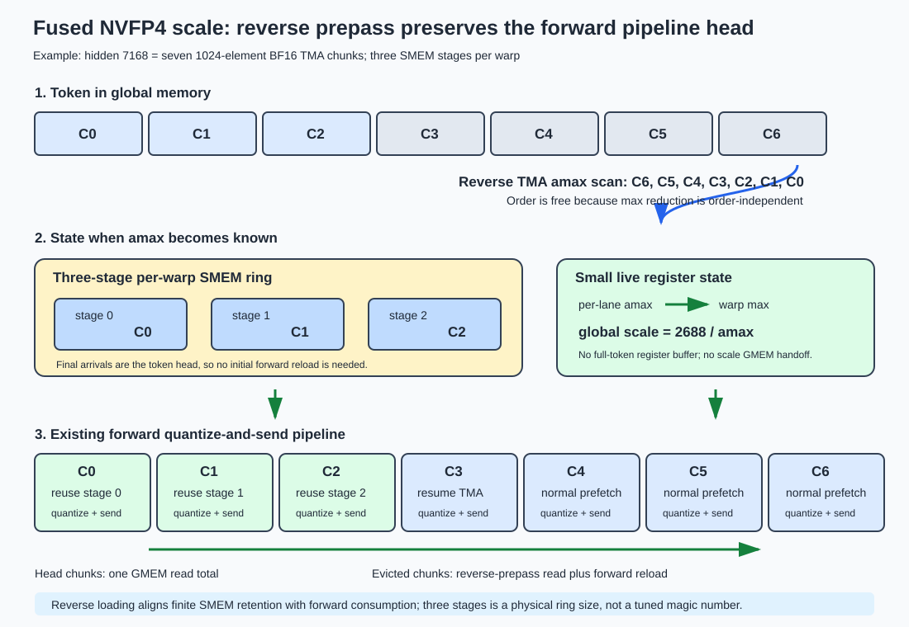

# Fused NVFP4 Combine Global-Scale Derivation

## Decision

Derive each NVFP4 global scale inside the low-latency combine kernel. Scan the
BF16 token in reverse with the existing three-stage TMA shared-memory ring,
then reuse the stages left resident at the head of the token in the ordinary
forward quantize-and-send pipeline.

This design removes the separate scale-precalculation kernel and scale-buffer
handoff while keeping register and shared-memory usage fixed as hidden size
grows. Fused derivation is the only public API behavior documented for NVFP4
combine. The earlier experimental caller-supplied-scale feature was removed
from the public API contract; a non-null scale pointer remains accepted only
as an undocumented compatibility path.

## Problem

NVFP4 quantization needs one global scale per post-expert token:

```text
global_scale = amax(abs(token)) == 0 ? 0 : 2688 / amax(abs(token))
```

The quantizer cannot produce any FP4 payload until it knows that scale, so it
must observe the complete unquantized BF16 token first. Previously, a separate
kernel computed the scales and wrote them to global memory. Combine then read
those scales and read the token again for quantization. That adds a kernel
launch, a scale-buffer allocation and handoff, and a global-memory round trip
for data that combine already has to consume.

The fused implementation must solve two competing problems:

- Compute a token-wide amax before quantizing the first chunk.
- Avoid retaining the full token in registers or shared memory and avoid
  rereading the entire token from global memory after finding the amax.

## Measurement method

Unless noted otherwise, measurements used four ranks on one Ptyche GB200 node,
low-latency expert-major combine, 128 tokens per rank, hidden size 7168, top-k
8, 256 experts, BF16 input, 20 warmup iterations, 100 measured iterations,
token dropping disabled, and validation enabled. Values are host-observed
average combine latency.

The caller-supplied-scale control is a combine-only lower bound. `ep_bench`
did not include the separate global-scale precalculation kernel in its timing
loop, so that number is not an end-to-end alternative to fused derivation.

These measurements used intra-node NVLink, the fastest available transport and
therefore the transport on which payload compression has the least opportunity
to help. The measured fused-NVFP4 improvement over BF16 is a lower bound for
the expected transport benefit. Slower transports such as inter-node RDMA
should benefit more from reducing the payload, although that expectation was
not measured in this experiment.

## Variants evaluated

| Variant | Strategy | Combine avg | Result |
| --- | --- | ---: | --- |
| Caller-supplied scale control | Load a precomputed scale, then use the existing TMA quantize/send path. | 31.25 us | Lower bound; excludes scale-precalculation work. |
| Direct two-pass GMEM | Read the whole token directly to compute amax, then let the normal TMA path read it again. | 45.87 us | Rejected: duplicates the full token read and is slower than BF16 combine. |
| Full register replay | Each lane retains its portion of the token in registers until the scale is known, then replays it. | 40.53 us | Rejected: removes rereads but makes register lifetime and pressure too expensive. |
| TMA tail replay | Scan through the existing three-stage SMEM ring; retain three chunks and reload the evicted chunks. | 33.66 us | Best initial design: fixed resources and only partial replay. |
| TMA plus register head | Keep four head chunks in registers and the remaining three chunks in SMEM for hidden 7168. | 34.95 us | Rejected: eliminating replay did not repay the added register pressure. |
| Reverse prepass plus shared forward pipeline | Scan tail-to-head so the SMEM ring finishes with the first three chunks, then reuse the normal forward path. | 33.87 us | Selected structure: similar primary-workload performance and simpler integration. |
| Final runtime `getGlobalScale` API | Select supplied versus derived scale from the pointer at runtime inside one helper. | 33.71 us | Selected implementation: no material cost from removing pointer-specific JIT variants. |

The initial TMA-tail result is the average of 33.50 and 33.82 us. The
caller-supplied control is the average of 31.43 and 31.07 us. The selected
fused path therefore costs about 2.5 us in combine relative to the control,
but the control omits the kernel and memory handoff that the fused path
removes.

### Why the alternatives lost

**Direct two-pass GMEM** has minimal live state, but it pays for a complete
extra token read before quantization. It is the simplest fused implementation
and the clearest evidence that avoiding register pressure alone is not enough.

**Full register replay** avoids the second GMEM read, but every lane must keep
its token fragment live across the token-wide reduction. The resulting
register footprint and long live ranges cost substantially more than replaying
some chunks through TMA.

**TMA plus register head** tried a hybrid for hidden 7168: four chunks in
registers and three in the SMEM ring, eliminating all token rereads. Its 34.95
us result was slower than the pure TMA-ring design. The extra registers were
more expensive than four coalesced TMA chunk reloads and would scale poorly as
hidden size grows.

**TMA tail replay** kept resource usage bounded and came within 7.7% of the
combine-only supplied-scale control. Its first form, however, naturally left
the tail chunks resident after a forward amax scan. Reusing those chunks
required a separate tail-first NVFP4 flow rather than the common forward send
pipeline.

## Winning pipeline



For the common hidden-7168 configuration, one TMA chunk contains 1024 BF16
elements. The token is seven chunks, `C0` through `C6`, and each warp owns a
three-stage SMEM ring.

1. `getGlobalScale` issues TMA loads in reverse order, `C6` through `C0`.
2. Each loaded chunk contributes to a per-lane amax; a warp reduction produces
   the token amax and `2688 / amax` scale.
3. Because ring stage is `chunk_index % 3`, the final three arrivals are `C2`,
   `C1`, and `C0`. When the reverse scan finishes, the ring contains exactly
   `C0`, `C1`, and `C2`.
4. `getGlobalScale` returns the scale and reports three preloaded stages.
5. The common forward loop begins at `C0`. It skips TMA loads and barrier waits
   for the three resident chunks, quantizes them, and sends them normally.
6. Starting at `C3`, the loop resumes its ordinary forward TMA prefetch,
   quantize, store, and send sequence.

### Why load in reverse

A forward amax scan leaves the *tail* of the token in a finite SMEM ring. The
normal quantization pipeline starts at the *head*. We would either have to
reload the head immediately or add a special tail-first quantization path and
then wrap around to the head.

The amax reduction is order-independent, so reversing only the prepass is free
semantically. It changes which chunks survive in the ring: the last arrivals
become the token head. That aligns the retained data with the next consumer
and lets NVFP4 rejoin the same forward pipeline used by the other combine
recipes.

The number three is not an empirical tuning constant. It is the number of
physical per-warp TMA buffers and barriers in the combine SMEM ring
(`combine_smem::kNumStages`). More generally, the helper reports
`min(num_chunks, kNumStages)` preloaded stages.

### Resource and traffic model

For `N` token chunks and `S = min(N, 3)` resident stages:

- The reverse prepass reads all `N` chunks once to compute amax.
- The forward path reuses `S` chunks from SMEM.
- The forward path reloads `N - S` evicted chunks.
- No token-sized register replay buffer is live.
- SMEM stays fixed at three TMA stages per warp.
- No global scale is written and read between kernels.

This deliberately trades bounded extra reads for bounded register and SMEM
pressure. At hidden 7168 it rereads four of seven chunks. As hidden grows, the
fixed three-stage reuse covers a smaller fraction of the token, so the gap to
the supplied-scale lower bound grows.

## Hidden-size scaling

The final runtime-helper sweep produced:

| Hidden | Chunks | Reused from SMEM | BF16 | NVFP4 supplied-scale control | Fused NVFP4 | Fused vs BF16 | Fused vs control |
| ---: | ---: | ---: | ---: | ---: | ---: | ---: | ---: |
| 1024 | 1 | 1 | 23.44 us | 24.82 us | 24.70 us | 5.4% slower | 0.5% faster |
| 2048 | 2 | 2 | 26.12 us | 25.50 us | 25.30 us | 3.1% faster | 0.8% faster |
| 4096 | 4 | 3 | 31.52 us | 27.42 us | 28.29 us | 10.2% faster | 3.2% slower |
| 7168 | 7 | 3 | 41.21 us | 31.10 us | 33.71 us | 18.2% faster | 8.4% slower |
| 8192 | 8 | 3 | 43.80 us | 32.29 us | 35.21 us | 19.6% faster | 9.0% slower |
| 14336 | 14 | 3 | 61.10 us | 42.05 us | 50.24 us | 17.8% faster | 19.5% slower |

At hidden 1024, launch and pipeline overhead dominate and fused NVFP4 is
slightly slower than BF16. From hidden 2048 onward, its smaller transport
payload outweighs the derivation cost. The increasing gap to the supplied-
scale control at large hidden sizes matches the `N - 3` replay model.

The reverse/shared integration improved hidden 14336 from 51.57 to 48.40 us
in its primary sweep while remaining effectively neutral at hidden 7168.
Focused reruns showed substantial host-timing outliers, so small differences
between 48--51 us at hidden 14336 should not be interpreted as a stable
pointer-check or pipeline regression without a larger controlled sample.

## Public API

The public NVFP4 combine contract exposes only fused derivation: the caller
selects `NCCL_EP_COMB_QUANT_NVFP4`, provides BF16 post-expert tokens, and does
not provide a scale tensor. Combine derives each row scale internally and
returns BF16 output. `ep_bench` exercises only this public mode.

An earlier experimental feature required callers to precompute and supply the
per-row FP32 scales. That feature has been removed from the public documentation
and benchmark interface. The implementation still recognizes a non-null scale
pointer for compatibility, but this is deliberately undocumented and is not a
second supported public mode. Its measurements in this PLC are retained only
as a performance control.

## Internal device API

The internal `getGlobalScale` helper owns the complete scale decision:

- A non-null compatibility pointer is loaded and reports zero preloaded stages.
- A null pointer runs the reverse TMA amax scan and reports how many head
  stages remain resident.

The internal caller receives a `float` scale plus `numPreloadedStages`; it does
not carry a separate pointer-presence boolean. The send path uses only the stage
count to decide whether to issue the initial load and where normal prefetching
and barrier waits resume. This keeps the control flow local and makes the
transition from scale calculation to the recipe-independent forward pipeline
visible in one place.

## Validation

- All experimental variants used `ep_bench --validate`.
- The selected implementation passed focused expert-major and rank-major
  correctness tests across Local Fanout, NVLink Dup, and supported Pull-Push
  transport variants.
- The final hidden-size sweep passed dispatch and combine validation for every
  BF16, supplied-scale control, and fused-derived case.
- After making fused derivation the only `ep_bench` mode, a fresh four-rank
  hidden-7168 run passed global dispatch and combine validation at 33.85 us
  average combine latency.

## Measurement provenance

- Original BF16 and supplied-scale reference: job 2836839.
- Initial variants: supplied-scale jobs 2837043 and 2837266; direct two-pass
  job 2837087; register replay job 2837111; TMA tail replay jobs 2837190 and
  2837268; TMA plus register head job 2837252.
- Clean initial hidden-size sweep: job 2839509.
- Reverse-prepass/shared-pipeline sweep and confirmation: jobs 2843388 and
  2843418.
- Final runtime-helper sweep and confirmation: jobs 2843517 and 2843545.
- Fused-only `ep_bench` rebuild and validation: job 2843661.

Raw logs are retained in the local Ptyche experiment workspace; this PLC keeps
the decision-relevant configuration and results with the implementation.

## Result

The reverse TMA prepass is the selected design because it is near the
combine-only lower bound at the primary workload, avoids token-sized register
state, keeps SMEM constant, removes the separate scale kernel and global scale
handoff, and integrates with the existing forward quantize/send pipeline
instead of maintaining an NVFP4-only pipeline. The measurements use NVLink,
so the observed transport speedup is the conservative case for compression.
