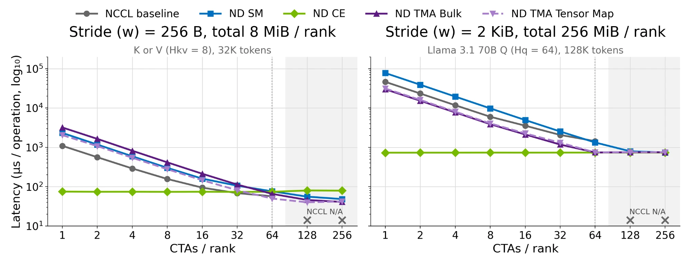
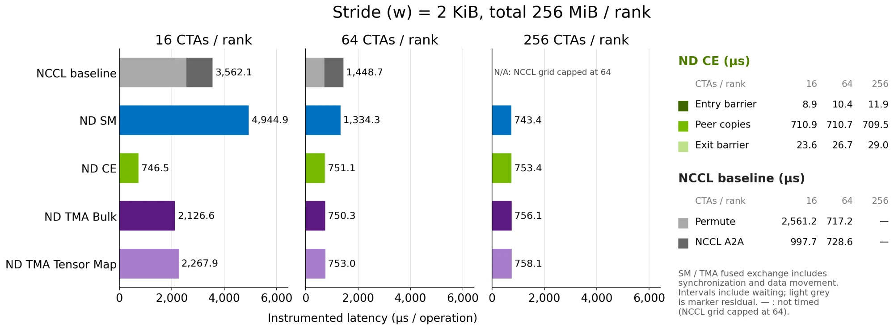
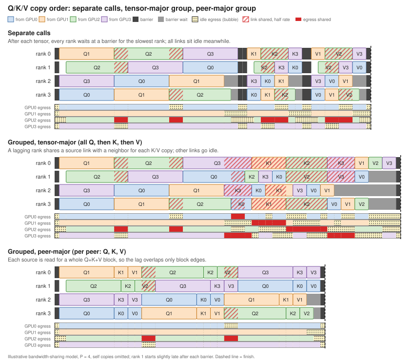

# NCCL ND PLC: Ulysses Redistribution

Internal design record for NCCL ND, excluded from the public export by
`PUBLIC_PATHS.txt`. It records why the module is built this way and the
evidence behind it; what the module does and how to use it are in
[`../README.md`](../README.md), and the per-function contracts are in
[`../include/nccl_nd.h`](../include/nccl_nd.h).

- Base module: [MR !291](https://gitlab-master.nvidia.com/nccl/nccl-extensions/-/merge_requests/291).
  Grouped calls: [MR !404](https://gitlab-master.nvidia.com/nccl/nccl-extensions/-/merge_requests/404).
  Follow-ups: [issue #161](https://gitlab-master.nvidia.com/nccl/nccl-extensions/-/issues/161).
- Presented at the NCCL ND PLC review on 2026-10-27
  ([deck](https://nvidia-my.sharepoint.com/:p:/p/dyoon/IQC7DWO6eS-YRaXRKCk-VHJmAbEI-QsmbBRrQcm748lz6d4?e=QGIeo9)).
  The deck records the design choices below; no PLC decision or sign-off was
  recorded.

## Problem

Ulysses context parallelism splits the sequence across ranks. Before attention,
an all-to-all of Q, K and V moves each rank from all heads of its sequence
chunk to the full sequence of its head group, so attention runs locally and
unchanged; a second all-to-all moves O back.

In the attention layout each peer's block is strided, while `ncclAlltoAll`
sends one contiguous chunk per peer. The usual path is a pack kernel,
`ncclAlltoAll` between scratch buffers, and an unpack kernel. Each permutation
reads and writes the whole tensor in HBM on SMs and is fast only with many
CTAs.

## Decision: copy each block into its final layout

NCCL ND copies each block from its source rank directly into its final position
on the destination rank, with no permutation kernel and no scratch buffer (the
README describes the layouts and the barrier/copy sequence). The remaining
choice is which engine moves the payload.

### Backend comparison

Standalone prototypes of four ways to produce the same final layout, measured
before MR !291:

- **NCCL baseline:** `ncclAlltoAll` with separate permutation kernels; the
  permutations are included in the timing.
- **ND SM:** a fused kernel reads peer data through NCCL LSA mappings and writes
  the final layout with vectorized SM loads and stores.
- **ND CE:** pitched peer copies (`cuMemcpy3DAsync`) into the final layout,
  between two NCCL device barriers of one CTA per rank.
- **ND TMA:** TMA loads peer data into shared memory, then SM stores write the
  final layout; Bulk and Tensor Map variants.

8x H100 80GB, BF16. CTAs per rank swept from 1 to 256 for the baseline and the
SM/TMA kernels; CE has no payload grid, so the sweep changes only its barrier
kernels. NCCL 2.30.7 caps its grid at 64 CTAs, so the baseline is not timed
above 64. Latency is `max_rank(median_samples(latency_us))`, 15 samples of 20
operations per graph replay. `w = (H/P)·D·2 B` is the contiguous row each peer
block contributes per token:

- `w = 256 B`, 8 MiB per rank: K or V with Hkv = 8 at 32K tokens.
- `w = 2 KiB`, 256 MiB per rank: Llama 3.1 70B Q with Hq = 64 at 128K tokens.

- **CE is flat across CTA counts**, because the copy engines move the payload:
  about 74 µs at 8 MiB and about 735 µs at 256 MiB.
- **At 256 MiB**, CE is about 4.8x faster than the baseline at 16 CTAs and about
  2x faster at 64. SM and TMA reach CE only at 64 CTAs or more.
- **At 8 MiB**, CE wins at low CTA counts but not at high ones: at 64 CTAs the
  baseline (57 µs) and TMA Tensor Map (50 µs) are faster, and at 256 CTAs SM
  and TMA reach 41-48 µs.

At 256 MiB (instrumented, one median sample on the slowest rank), CE time is
almost entirely peer copies, about 710 µs at every CTA count. The entry and
exit barriers add 9-12 µs and 24-29 µs. The baseline's permutation alone takes
2,561 µs at 16 CTAs and 717 µs at 64.

**Decision:** CE is the only backend. It does the payload without SM work and
is fastest at the large Q shape regardless of CTA count. At small shapes with
many CTAs available, SM or TMA can be faster; the module does not select
backends at run time.

### API decisions

- **Borrowed storage.** The input is addressed through a symmetric window and
  offset, the output through a device pointer; the library never allocates or
  registers payload memory, so frameworks keep ownership and graph capture sees
  fixed addresses.
- **Physical axes, not directions.** `scatter_dim` and `gather_dim` name tensor
  axes, so both directions use one call and later layouts need no new flags.
- **Batching.** The deck proposed a tensor-array call,
  `ncclNdAllToAllBatch(handle, inputs, outputs, n, scatter_dim, gather_dim,
  stream)`, to put Q/K/V under one barrier pair. MR !404 implements the
  batching as groups instead (next section).

## Grouped calls ([MR !404](https://gitlab-master.nvidia.com/nccl/nccl-extensions/-/merge_requests/404))

### Why a group instead of a tensor-array call

The group follows `ncclGroupStart` and `ncclM2nGroupStart`:

- The grouped calls are ordinary `ncclNdAllToAll` calls, so Q (Hq heads) and
  K/V (Hkv heads) keep their own descriptors and axis pairs, and a caller that
  already issues three calls only wraps them.
- The signatures take no parameters, so the API grows by two functions and no
  descriptor array type.
- Nesting lets a framework layer open a group around code that may itself open
  one.

### Copy order

The outermost `ncclNdGroupEnd` enqueues one entry barrier, every recorded copy
and one exit barrier; each call contributes one copy per peer in the rotated
order `(rank + i) % P`.

8x H100 80GB HBM3, driver 580.82.07, CUDA runtime 13.0, NCCL 2.30.7. BF16, B=1,
D=128, sequence-sharded to head-sharded. Each mode is one CUDA Graph of 20
Q/K/V sets; 5 warmup replays and 15 samples; per sample the slowest rank's
latency divided by 20; every sample's output is verified. Measured with
`bench/qkv_bench.cu` (`bench/run_bench.sh 8`). Latency in µs per Q/K/V set,
median:

| Hq/Hkv, global tokens | 3 separate calls | Grouped, tensor-major | Grouped, peer-major | Peer-major vs separate |
| --- | ---: | ---: | ---: | ---: |
| 64/8, 1K | 130.9 | 107.7 | 92.6 | 1.41x |
| 64/8, 32K | 364.8 | 345.5 | 320.8 | 1.14x |
| 64/8, 128K | 1014.2 | 1056.0 | 961.2 | 1.06x |
| 64/64, 32K | 653.0 | 701.7 | 612.7 | 1.07x |

The min-max range stayed within 3.5% of the median in every cell.

- Grouping saves most at small sizes, where the barriers dominate.
- **Tensor-major** (all Q copies, then all K, then all V) is slower than three
  separate calls at 128K and in MHA, so removing barriers alone does not explain
  the gain at large sizes.
- **Peer-major** (for each rotated peer, that peer's Q, K and V copies) is
  faster than both in every measured case, with no extra synchronization.
- Proposed explanation, not measured directly: under tensor-major, ranks that
  drift apart at a tensor boundary can read the same source GPU's egress link
  at once while other links idle; peer-major keeps each rank on one source for
  a whole Q+K+V block.

**Decision:** peer-major is the only shipped order. The header leaves copy order
and in-group synchronization unspecified, so they can change (for example to
the chunked schedule in the follow-ups) without an API change.
`NCCL_ND_COPY_ORDER=tensor` exists only to reproduce this comparison.

### Group compatibility

Summary of the contracts in the header, with how each is enforced.

| While an ND group is open on this thread | Behavior | Enforced |
| --- | --- | --- |
| `ncclNdAllToAll` | Validated, copy descriptors resolved and recorded; enqueued by the outermost `ncclNdGroupEnd` | Yes |
| First recorded call | Binds the handle, stream and capture state (outside capture, or one capture session) | Yes |
| Later call with another handle or stream | `ncclInvalidUsage`; fails the group | Yes |
| Capture begun or ended on the stream after the first call | Fails the group if the change is still in effect at a later call or the outermost end | Partly: a capture opened and closed between two such points is not observed |
| `ncclNdGetVersion` | Runs immediately; does not participate | Yes |
| `ncclNdCreate`, `ncclNdDestroy` (any handle, including NULL) | `ncclInvalidUsage`; fails the group | Yes |
| Rejected `ncclNdAllToAll`, `ncclNdCreate` or `ncclNdDestroy` | Fails the whole local group; later `ncclNdAllToAll` and the outermost end return the first error; nothing is enqueued | Yes |
| `ncclNdGetVersion` error, or nesting-depth overflow in `ncclNdGroupStart` | Returned to the caller; the group is unaffected | Yes |
| Inner `ncclNdGroupEnd` | Closes one level; returns `ncclSuccess` and enqueues nothing, even after a failure | Yes |
| Outermost `ncclNdGroupEnd` | Needs the handle's device current; clears the group on every outcome; start/end must stay balanced after an error | Yes |
| Empty group | Succeeds and enqueues nothing | Yes |
| Completion | Outputs are ready and inputs reusable at stream completion, not when `ncclNdGroupEnd` returns | Not applicable |
| Overlap between grouped calls (output with another call's input or output) | Unsupported; caller guarantees independence | No: checked within a call only |
| A grouped call consuming another's output | Unsupported; recording order is not completion order | No |
| Other CUDA work on the stream while the group is open | Runs before the group's work | Not applicable |
| Native NCCL communication, or `ncclGroupStart`/`End` | Unsupported in either direction; the two group states are independent | No: NCCL exposes no group state to query |
| Ranks recording different calls or metadata | Unsupported; may hang in a barrier or produce wrong output, since a rejection is local and ranks are not compared | No |

## Failure analysis

A rejection before submission enqueues nothing on the rejecting rank; it is not
a distributed rollback, so ranks that disagree leave peers waiting. A failure
during submission, for a single call or a group, can leave partial collective
work:

| Failing step | Submitted on the failing rank | Peers |
| --- | --- | --- |
| Entry barrier launch | Nothing | May wait in the entry barrier |
| A copy | Entry barrier and earlier copies; the exit barrier is still attempted | Proceed only if that exit barrier launches; output undefined |
| Exit barrier launch | Entry barrier and every copy that was submitted | May wait in the exit barrier |

Clearing the host group state does not make the handle or communicator
reusable, so the README's recovery procedure aborts the communicator.
`nd_fault_test` injects each of the three failures on every rank, for single
and grouped calls; asymmetric failures, where only some ranks fail, are not
covered.

## Validation evidence

On cw-pdx (8x H100, CUDA 13.0, NCCL 2.30.7), each of the three MR !404 commits
builds with Make and CMake and passes `run_tests.sh 2 8` (`nd_test` and, from
the second commit, `nd_fault_test`), and the benchmark above passed with every
sample verified. The GitLab pipeline result is not recorded here.

## Follow-ups ([issue #161](https://gitlab-master.nvidia.com/nccl/nccl-extensions/-/issues/161))

- **FlashInfer integration.** Replace pack, all-to-all and unpack in
  FlashInfer's Ulysses path and compare attention-layer and step time on real
  shapes; the results so far are standalone microbenchmarks. Whether Q/K/V are
  dense at the all-to-all boundary sets the priority of strided views.
- **Strided views.** Q/K/V slices of a fused QKV buffer and head-offset outputs
  fit pitched copies when the head/D region is contiguous. The layout code
  needs strides and storage spans instead of a dense size; the group design is
  unaffected.
- **Comm-attention overlap.** In review of MR !291, a B200 prototype from the
  TRT side overlapped per-head-group copies with that group's attention,
  signalling with `cuStreamWriteValue32` instead of barrier kernels. That needs
  per-chunk readiness, which the group does not expose; it would be an
  additive API, and the existing group keeps completion at the outermost end.
- **SM-initiated CE** is blocked on driver support for pitched or aggregated
  device-side copies. The device API is 1-D only, so a prototype needed one
  copy per 256 B row (32,768 copies per op) and took 160-310 ms per op against
  51-76 µs host-initiated.
- **Uneven extents.** Whole-parameter ownership in Megatron-FSDP (for
  optimizers such as Muon) makes shard sizes unequal. The per-rank descriptors
  may extend to uneven extents later.
